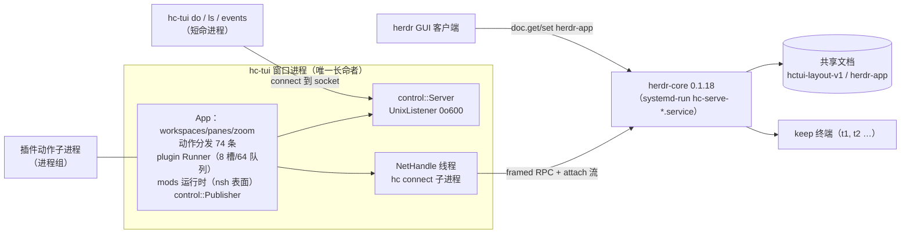

# ADR-0002：hc-tui 的进程拓扑（工作台逻辑由谁持有）

- Status: **Proposed**（待 m11a 的统一清单 v2 落地后转 Accepted；本 ADR 不改 `src/`）
- Date: 2026-11-07
- Decision: **不新增 hc-tui 自己的常驻进程类型**（新的长跑进程只以 core 终端的形式出现，生命周期所有者是 core 的 systemd 单元）。把「必须活过窗口」的三件事分别落到已有的、已经有生命周期所有者的东西上：状态 → core 的共享文档（`hctui-layout-v1` / `herdr-app`，CAS + 三方合并）；长跑执行 → 本地 core 的 keep 终端；控制与订阅 → 无窗口时由 `hc-tui` 的短命 CLI 直连 core。插件清单里的常驻需求写成 `hctui.toml` v2 的 `[[services]]`，物化成 core 终端作业，不引入第二套清单格式。
- 相关：[plugins.md](../plugins.md)、[mods.md](../mods.md)、[gap-vs-herdr.md](../gap-vs-herdr.md)、[herdr-app-alignment.md](../herdr-app-alignment.md)、[plan-extensions.md](../plan-extensions.md)、[0001-ghostty-vt.md](0001-ghostty-vt.md)
- 票：`/home/wxb24/tickets/rt1`（证据在 `evidence/`，决定轨迹在 `.audit/trail.tsv`）

---

## Status

Proposed。决策本身与 m11a 有顺序依赖：`[[services]]` 必须长在 m11a 的 v2 统一清单里，不能在 `plugin.toml` 上再开一段。阶段 1 与 m11a 无关，可以独立落地并验收。

---

## Context

### C.1 复核发起方的「已知事实」

brief 的事实大部分成立，但有三条必须改写，否则后续论证会建立在错的诊断上。

| # | brief 的主张 | 复核结果 | 证据 |
|---|---|---|---|
| 1 | `src/shared.rs:8` `DOCUMENT = "herdr-app"`，布局经 `doc.get/doc.set` 存在 core | **成立** | `src/shared.rs:8`；写入在 `src/app/shared_sync.rs:222` |
| 2 | 选择/焦点/zoom/settled 存在 `hctui-layout-v1` schema 3 | **部分错**：焦点与 `settled` 在；**`zoom` 不在任何文档里**，它是纯瞬态，`snapshot()` 不输出它 | `src/app.rs:99`、`src/app.rs:6030-6078`、`src/model.rs:550-558`（`SavedState` 无 zoom 字段）、`src/app.rs:439`（`pub zoom: bool` 只在内存） |
| 3 | `src/app.rs` 共 8217 行，工作台逻辑全在一个事件循环 | **成立** | `wc -l src/app.rs` = 8217 |
| 4 | `src/app.rs:833` 控制 socket 只有 9 个方法 | **成立**，另有第 10 个伪方法 `events`（长连接订阅，不走 `control_reply`） | `src/app.rs:833-866`；`src/control.rs:206-213` |
| 5 | `pump()` 一个函数干三件事，生命周期本该不同 | **成立** | `src/app.rs:870-902` |
| 6 | `src/main.rs:216` 控制 socket 由运行中的 TUI 监听，没 TUI 就没人应答 | **成立**（实测 `Connection refused`） | `src/main.rs:216`、`src/control.rs:155-172`；`evidence/02-window-dead.txt` |
| 7 | `src/control.rs` 455 行，只做收发与广播 | **成立** | `wc -l src/control.rs` = 455 |
| 8 | runner 限额 8 / 4 / 64 / 64 KiB，stdout 只作日志 | **成立** | `src/plugin/runner.rs:25,27,29,31`；`docs/plugins.md:94,287` |
| 9 | `docs/plugins.md` §1/§13、`docs/mods.md` §16 说生命周期跟随客户端 | **成立，但与实现不符**：三种植入的结束方式里只有一条真的回收子进程 | `docs/plugins.md:13,288`、`docs/mods.md:493`；`evidence/03-plugin-*.txt` |
| 10 | `docs/tern-tsp-compat.md`「把文档存在 viewer 里就丢重连」 | **成立** | `docs/tern-tsp-compat.md:18,36` |
| 11 | herdr 102 方法 / core 32 / hc-tui 8 | **前两个成立，第三个过期**：源码实测调用 24 个 core 方法（+`hello`） | `hc connect` hello 的 `methods` 长度 32；`.rpc(`/`call_rpc(` 抽取得 24；`evidence/08-core-methods-cas.txt` |
| 12 | `docs/plan-extensions.md` M1–M8 + M10 已交付、M9 未开始、无 M11 | **成立** | `docs/plan-extensions.md:82-297` |
| 13 | `~/.config/hc-tui/` 只有 `config.toml` | **成立** | `ls -la ~/.config/hc-tui/` |

关于「herdr 0.9.3 的 daemon 实测」：全部复核成立，且比 brief 记的更绝对——herdr 的插件清单里**没有任何常驻段**，`[[startup]]` 是"每次启动执行一次的一次性钩子"，web-ui 插件直接在源码里写明这件事并自己接管进程。

```
$ for f in ~/.config/herdr/plugins/github/*/herdr-plugin.toml; do grep -oE '^\[\[[a-z]+\]\]' $f | sort -u; done
[[actions]] [[build]] [[panes]]                 # annotate
[[actions]] [[build]]                           # collie
[[actions]] [[build]] [[panes]] [[startup]]     # herdr-web-ui
$ sed -n '1,8p' .../herdr-web-ui/scripts/plugin.ts
 * herdr's startup hooks are one-shot initialization commands, not supervised
 * daemons (https://herdr.dev/docs/plugins/), so this script owns the process:
```

复跑（2026-11-08，`docs/adr/evidence/09-herdr-facts.txt`）：`[[startup]]` 的实际字段只有 `command`（argv 数组）与可选的 `platforms`（web-ui 清单 `:34-40` 两条：`command = ["sh", "scripts/with-bun.sh", "scripts/plugin.ts", "start"]` / `platforms = ["linux", "macos"]`，以及 PowerShell 同构的一条），没有 `restart`、`supervise`、pid 之类字段。collie 的现场：`systemctl --user list-units --all | grep collie` 给出 `collie.service loaded active running Collie`；`systemctl --user cat collie` 的单元里有 `Restart=on-failure`、`RestartSec=5`、`StartLimitIntervalSec=0`，`ExecStart=/usr/bin/bun run …/bridge/index.ts`；单元由 `collie-ctl.sh:9` 的 `UNIT="collie"` 生成、`:360` 的 `systemctl --user daemon-reload` 安装。

（`docs/adr/evidence/09-herdr-facts.txt`）结论：herdr 侧「抄插件模型」解决不了常驻，连它自己的常驻桥都是 `systemd --user` 单元（`collie-ctl.sh:9` `UNIT="collie"`、`:360` `systemctl --user daemon-reload`）+ 插件自管 pid 文件。这条对本文的候选 2 是直接反例。

### C.2 三个缺口（本文统一口径）

brief 没定义「三个缺口」，本文把它固定成可测量的三条，后面每个候选都按这三条打分。

| 缺口 | 定义 | 今天的状态 | 实测 |
|---|---|---|---|
| **G1 状态留存** | 窗口退出后，工作台状态（布局、焦点、已读、外框）仍在，并能被下一个窗口接上 | **基本已解决**，但有两个洞：400 ms 防抖窗口内异常退出丢最后一次变更；第二个写入者的写会被窗口覆盖（LWW） | `evidence/04-debounce-kill.txt`（`version=0`）、`evidence/05-clobber.txt`（`EXTERNAL` 被覆盖） |
| **G2 执行留存** | 插件动作、mod 动作在窗口退出后仍跑完，结果可查 | **未解决**。`app.quit` 路径回收子进程；SIGTERM / SIGKILL / tmux hangup 三条路径都留下孤儿子进程 | `evidence/03-plugin-quit.txt`（回收）、`evidence/03-plugin-kill.txt` / `-term` / `-hangup`（`sleep 500` 仍活） |
| **G3 控制与订阅留存** | 没有窗口时 `do` / `snapshot` / `events` 仍应答 | **未解决**。socket 由窗口进程 bind，窗口死即 `ECONNREFUSED`，残留 inode 没人 listen | `evidence/02-window-dead.txt` |

G1 的措辞很重要：**状态不是「在不在内存」的问题，是「谁是权威」的问题**。`App` 在内存里持有一份 `workspaces`/`panes`（`src/app.rs:363-534`），core 文档里另有一份由它 `snapshot()` 推上去的副本（`src/app.rs:6008-6020`）。窗口每次保存都用自己那份覆盖文档，冲突时只重取版本号、不重取内容（`src/app.rs:5709-5716`、`src/app.rs:5739-5742`）。所以持久化已经有了，**归属没有**。

### C.3 现状拓扑



窗口一死：`Ctl` 消失（G3），`Runner` 失去回收者（G2），`App` 的内存状态无人再推（G1 的洞暴露）。

### C.4 core 已经具备的常驻能力（实测）

| 能力 | 事实 | 证据 |
|---|---|---|
| 进程存活 | core 由 `systemd-run` 的 transient unit 托管；属性 `Type=exec`、`KillMode=process`、`RuntimeDirectoryPreserve=restart` | `evidence/10-core-leak.txt` |
| 终端存活 | `hc run --bg --keep` 起的终端 `keep:true`、`die_with_parent:false`，客户端全退出后仍 `live`；`hc server stop` 会"停泊"它们，下次 core 启动给 shell | `evidence/06-core-durability.txt` |
| 结果可取 | 结束的终端带 `exit_code` / `reason`（`t2 finished 7 exited`） | 同上 |
| 输出可取 | `hc read` 给屏幕；但那是**渲染后的屏幕**：ESC 序列丢失、`\r`→`\n`、`NUL`→空格（`A\nB RED\nC D\n`） | 同上（`od -c`） |
| 多写入者协调 | `doc.set` 带 `version`；发陈旧版本返回 `kind:"conflict"` + `hint:"read doc.get and retry with its version"` | `evidence/08-core-methods-cas.txt` |
| 多持有者 | `server.status` 返回 `holders[]`（各自 pid / terminals）、`live`、`uptime_ms` | `hc server status`（本机当时 `holders` 2 项、`live` 38、`uptime_ms` 175130184） |
| 事件流 | `events.subscribe` 一条长连接，任何短命进程都能订 | `src/hc/net.rs:500`、`src/main.rs:139-240` |
| 往返成本 | 同一连接上 `doc.get` p50 **0.21 ms**、p90 0.28 ms；无窗口 `hc-tui do` 整条链路（进程启动 + 连 core + 读改写文档）p50 **22.8 ms**、p90 24.7 ms | `docs/adr/evidence/07-latency.txt` |

**这台机器同时证明了「按需起常驻进程」的真实成本**：132 个 `herdr-core serve` 主进程、78 个不同 cgroup、184 MB RSS，而正在跑的窗口只有 1 个。它们全部来自测试与临时会话，没人回收。

```
$ pgrep -c -f "herdr-core serve"                     → 136（含 4 条匹配到该字符串的 shell）
$ 其中 argv 等于 `/…/herdr-core serve` 的主进程        → 132，129 个 ppid=1107（user manager 直接拉起）
$ 按 /proc/PID/cgroup 归类                            → 78 个不同 cgroup
$ ps 总 RSS                                          → 184 MB / 136 进程
```
（`evidence/10-core-leak.txt`）

这直接否掉「再加一个常驻进程就好了」这条路：多一个进程不是问题，**多一个没人负责生死的进程**才是。

---

## Decision

**采纳候选 4：把常驻需求回收进 core 与 systemd，`hc-tui` 保持纯客户端。**

这不是「零进程」：新的长跑进程仍然会出现（服务的执行体就是 core 里的一个终端），区别在于**它的生命周期所有者不是 hc-tui**，所以窗口退出不再杀死它，也不需要 hc-tui 去当守护者。三条机制，每条都借用已有所有权：

1. **状态真相 = core 文档，窗口只是副本。** `hctui-layout-v1` 的写入走与 `herdr-app` 同一条路：`doc.get` 取 `(base, version)` → 把本地意图与远端值做三方合并（`src/shared.rs:310` `merge`）→ `doc.set` 带版本提交 → `conflict` 就重取重放；合并不了就**阻塞自动覆盖**并要求 `layout.reload`（`src/app/shared_sync.rs:100-120` 已有这套语义与提示）。窗口退出前、收到 SIGTERM/SIGHUP 时都要 flush（今天只有 `app.quit` 路径 flush，`src/app.rs:7285-7307`）。
2. **长跑执行 = 本地 core 的 keep 终端。** 需要在窗口退出后继续的动作，声明为 `[[services]]`，宿主把它物化成 core 里的 keep 终端：`terminal.run` 带 `--keep` 语义（`keep:true`），日志落文件，状态从 `terminal.get/terminal.read` 读。窗口不在时它照跑，因为它的所有者是 core 的 systemd 单元，不是窗口。
3. **控制与订阅 = 无窗口时直连 core。** `hc-tui do` 增加一条无窗口路径：一次进程生命周期内 `hc connect` → `doc.get` → 用纯函数计算新文档 → `doc.set`（CAS）→ 需要终端时 `terminal.run` → 退出。屏幕类动作（`pane.focus`、`pane.zoom`、`layout.*` 的显示部分、`overlay.close`）显式返回 `needs_window`，不再让调用方等一个 5 秒超时。

数据形状、模块边界、谁保证不变量：

- **文档复制**：形状 = `SavedState`（`src/model.rs:550`，`schema_version=3`）。边界：`src/app/shared_sync.rs` 是唯一允许写 `herdr-app` 的地方（今天如此），`hc-tui-layout-v1` 的读写必须收敛到同一个 `Replica` 结构，`src/app.rs` 里的 `push_layout/request_doc` 退化成调用它。不变量：**任何一次成功写入都必须基于它刚刚读到的 `version`；窗口与 CLI 走同一套合并逻辑；合并失败宁可不写**。由 `doc.set` 的 CAS 与 `shared::merge` 保证。
- **服务物化**：形状 = 清单里的 `[[services]]`（`hctui.toml` v2）+ 运行期一条 `{package, service, generation, terminal, started_ms, keep}` 记录，写进**独立文档 `hctui-services-v1`**（不与布局文档混写：布局文档是整份重写的，混进去会在下一次窗口保存时被删掉）。边界：清单解析在 `src/plugin/manifest.rs`/`src/pkg/mod.rs`（`deny_unknown_fields`，加段必须同时加校验），物化与回收在新模块（建议 `src/plugin/service.rs`），执行体是 core 的终端，`hc-tui` 只做"声明 → 作业"的翻译。不变量：**一个 (package, service) 至多一个活终端；终端地址写进文档才能被下一个窗口看见；禁用/卸载包必须停掉终端**（复用现有 lease 的代际思想 `src/plugin/lease.rs:109`）。

### D.1 `[[services]]` 的形状（挂在 v2 统一清单上）

m11a 的 `hctui.toml` v2 已把 actions / terminals / module 合到一个解析器（`src/pkg/mod.rs:1-11`）。`[[services]]` 是它的第四段，字段与 `[[actions]]` 同一套词汇，只多三个可选的运行期字段：

```toml
[[services]]
id = "bridge"                       # 同 actions/terminals 的 id 规则
title = "Web bridge"
argv = ["bun", "run", "bridge"]     # 与 actions 同义：cwd 是包目录，./ 相对解析
cwd = "."                           # 可选，默认包目录
env = { PORT = "8787" }             # 可选
on = "local"                        # local | space-machine，默认 local（保持"动作在客户端主机"的现有语义）
log = "state"                       # state | off，默认 state：落 ~/.local/state/hc-tui/services/<pkg>/<id>.log
# 不提供 restart：重启策略属于包自己（见「不做的事」）
```

不写成 `[[daemons]]` / 独立清单：一段、一个解析器、一套 `文件:行:列: 原因` 报错，和 m11a 的合并方向一致。

### D.2 无窗口分派的能力边界

`hc-tui do` 的 74 条动作（`hc-tui commands`）按效果分两类，无窗口路径只接第一类：

| 类 | 例子 | 无窗口行为 |
|---|---|---|
| 有持久效果 | `space.new`、`space.rename`、`space.move`、`tab.new`、`tab.rename`、`tab.settle`、`pane.split`、`pane.close`、`pane.swap`、`terminal.open`、`terminal.keep`、`terminal.kill`、`terminal.park`、`terminal.pin`、`plugins.*` | 读文档 → 算新文档 → CAS 写；涉及 core 的再发 `terminal.*` |
| 只改屏幕 | `pane.focus`、`pane.zoom`、`pane.go`、`layout.show/hide/toggle/switch`、`app.palette/settings/help`、`overlay.close`、`terminal.scroll/search/copy`、`chat` 相关 | 返回 `{"error":"needs_window","method":…}`，非零退出码 |

这个切分不是新造的：它正好对应「文档里有的」与「`SavedState` 里没有的」那条线（`src/model.rs:550-558` vs `src/app.rs:363-534`）。

一个必须点明的实现陷阱：这 74 条里有些动作是"先 `ask()` 打开提示、再由 `commit_prompt()` 落地"（`src/app.rs:2915`、`src/app.rs:3696`）。实测 `hc-tui do space.rename '{"label":"x"}'` 返回 `{"accepted":true,"confirmation_pending":true}` 但**什么都没改**——参数在提示里被丢弃。无窗口路径必须直接走 `commit_prompt` 的落地分支（参数已经在 `args` 里），不能复用带 `ask()` 的外壳。

---

## Consequences

**得到的**

- G2、G3 被消掉，且不引入新的长命进程类型。窗口从进程退化成视图：连上就渲染，关掉什么都没断。
- G1 的两个洞被补齐：异常退出不再丢最后一次布局；第二个写入者（CLI、GUI、另一台机器的窗口）不再被静默覆盖。
- 顺带修掉一个与 G1 同源的真 bug：今天的 `doc.sync` 只更新版本号就重推本地状态（`src/app.rs:5709-5716`），等于"确认冲突后仍然覆盖"。
- 跨端优势保留：core 仍只发原始 VT，手机的 `hc`、`ssh box hc connect` 都不受影响；没有为了工作台语义去动 core 的协议。

**付出的**

- 无窗口能力是「读改写文档」的模型：一次 `do` 至少两次 RPC（实测持久连接上 `doc.get` p50 0.21 ms，进程启动主导，无窗口整条 p50 22.8 ms / p90 24.7 ms，`docs/adr/evidence/07-latency.txt`）。交互路径不变的仍然是窗口内那条。
- 服务只能用 VT 输出看日志（`ESC`/`NUL` 丢失，实测）。需要精确字节流的作业必须写文件/端口，不能把 stdout 当协议——这条与现有 runner 的约定一致（`docs/plugins.md:94`），只是把同样的约束延伸到常驻作业。
- 文档写入从"想写就写"变成"先读、合并、CAS 写、可能被阻塞"。多了 `layout.reload` 这样的用户动作。
- 一处代码重复的诱惑：动作执行 `execute_action`（动作表在 `src/app/actions.rs`，`app.quit` 在 `:97`；分发在 `src/app.rs:838-857`）在无窗口路径里需要一份不依赖渲染状态的入口。必须在同一个函数族里做条件分支，不能抄一份。

**新增的故障模式**

| 故障 | 触发 | 兜底 |
|---|---|---|
| 合并阻塞 | 两个写入者改同一字段（如同一个 tab 的 `focus`） | 停止自动覆盖，提示 `layout.reload`（复用 `src/app/shared_sync.rs:108-120`）；`do` 返回 `{"error":"layout_conflict"}` |
| 服务终端被意外 kill | 用户 `hc kill`、core 重启 | `hctui-services-v1` 里的台账与新终端对不上时，下一个窗口报 `service_stale` 并提供 `plugins service restart`；不自动重起（避免重启风暴） |
| 服务泄漏 | 卸载包 / 禁用包时没停终端 | 物化时把 `(package, generation)` 写进终端 label，卸载时按 label 反查并 `terminal.kill`；AC 见阶段 2 的 2d |
| 无窗口路径与窗口路径行为漂移 | 同一动作两条实现 | 两条路径必须调用同一个动作函数；验收用同一份命令断言两种上下文结果一致（阶段 2 的 2e） |
| 会话数量失控 | 无窗口 CLI 顺手起了新会话的 core | `do` 只允许连**已存在**的 core（`hc connect` 默认会按需拉起）→ 必须改成"没有就报 `no_core`"，并复用 `evidence/10-core-leak.txt` 的泄漏数作为回归指标 |

**回退**

- 阶段 1 是行为修正，回退 = 恢复 `push_layout` 的直接写入 + 去掉信号处理，文档格式不变，下一个窗口照常读。
- 阶段 2 是纯增量：`[[services]]` 段可选，没有它清单照常加载（严格解析器只在出现时校验）；不用的服务可用 `hc kill <addr>` 停掉，不需要回滚代码。
- 没有引入布局文档的版本升级：`hctui-layout-v1` 的 `schema_version` 仍是 3，格式不动；服务台账是**另一个文档** `hctui-services-v1`，不存在即没有服务，删掉即回退。

---

## Alternatives considered

五个候选同口径比较。`改动面` 的行数是粗估（按现有文件规模），不是承诺。

### 候选 0：什么都不改

- **改动面**：0 行。
- **消掉缺口**：G1 大部分（已实测成立），G2 0%，G3 0%。
- **新增故障模式**：已经在发生——①孤儿动作进程（三种退出方式均实测）；②400 ms 丢写；③`do` 在无窗口时直接失败，脚本/CI/cron 无法使用工作台；④第二个写入者被覆盖。还有一条隐性的：文档说"detach 后动作结束"（`docs/plugins.md:288`），实现只在 `app.quit` 路径做到，**文档与实现的偏差本身就是故障**。
- **回退成本**：无（不变就是回退）。
- **对 herdr-app 共享 core 的影响**：无新增；但 `hctui-layout-v1` 的 LWW 语义与 `herdr-app` 的 3-way merge 语义不一致，两个文档对同一个"布局"给出两套并发规则，这个不一致会长期咬人。
- **结论：否决。** 不是因为它"保守"，而是因为它的成本被低估了：0 不等于"没有常驻"，而是"有常驻、没有负责人"——132 个 core 进程 / 78 个 cgroup / 184 MB 就是这台机器上交的账单（`evidence/10-core-leak.txt`）。

### 候选 1：把工作台语义塞进 hc core

- **改动面**：主要成本在**本仓库之外**（`herdr-core` 是另一个发行：`hc 0.1.18`，32 个方法，原始 VT 协议）。本仓库需要改 `src/hc/client.rs`（303）、`src/hc/net.rs`（1174）、`src/hc/proto.rs`（446）与 `src/app/shared_sync.rs`（600）来对接新方法；core 侧要新增"工作台对象"（spaces/tabs/panes/zoom）与插件宿主，粗估 1500+ 行且跨仓库同步发版。
- **消掉缺口**：G3 彻底（core socket 本来就在）；G2 可以（动作在 core 里起进程）；G1 不变（文档仍要合并语义）。
- **新增故障模式**：core 与 hc-tui 的版本耦合成硬故障（`hello.generation != 1` 直接 `Fatal`，`src/hc/client.rs:60`、`src/hc/client.rs:152-157`）；core 重启会带走工作台；每个 core 消费者（手机、`hc` CLI、`ssh` 里的 `hc connect`、herdr GUI）都被迫承载 hc-tui 的对象模型与插件运行器；插件以用户身份跑，而 core 是跨机器可达的——攻击面从"你桌上的一个 TUI"扩到"所有能连 core 的端"。
- **回退成本**：高。core 与客户端的 idl 版本必须同时回滚，旧窗口连不上新 core（无降级路径）。
- **对 herdr-app 共享 core 的影响**：**最坏**。`herdr-app` 文档是 hc-tui 与 herdr GUI 的共同契约（`src/shared.rs:1` 注释、`src/app/shared_sync.rs:21`），把 hc-tui 的工作台模型写进 core，会让 GUI 也被迫遵守它，等于用 hc-tui 的实现细节重定义共享契约。
- **结论：否决。** 边界错了：core 的契约是「终端 + 文档 + 事件」，它刻意对 UI 没有意见，这正是不装 hc-tui 的客户端也能用它的原因。

### 候选 2：独立的第二服务端（新进程）

- **改动面**：新进程入口 + 一个 `App` 的无绘制模式（`src/app.rs` 的 `run()` 需要拆出循环）、`src/control.rs`（455）迁到新进程、`src/plugin/*` 全体（runner 1116 + registry 914 + lease 585 + manifest 1031 ≈ 3.6k）迁出窗口、`src/main.rs`（1255）增入口、窗口侧要一个新的"只读快照 + 增量"协议（今天 `snapshot` 只有一问一答，`src/app.rs:834-836`）。粗估 1200-1800 行新增，600 行搬迁。
- **消掉缺口**：G2、G3 全消；G1 需要合并语义（否则就是两个 `App` 两个写者）。
- **新增故障模式**：①**两个 App = 两个写者**，实测同构后果是静默覆盖（`evidence/05-clobber.txt`）；②新进程的生命周期没人负责——本机已有 132 个这样的进程作为先例；③systemd 单元 + socket 路径 + 会话哈希三套寻址（`src/control.rs:24-42` 已按 session 哈希派生 socket），升级时两个进程版本必须匹配；④窗口变成一个只能看快照的瘦客户端，`do` 的两条语义路径（窗内/窗外）都要维护。
- **回退成本**：中。停 unit、回退 CLI、文档格式不变；但如果已经产生"窗口写文档、服务端也写文档"的数据，回退后仍要人工合并。
- **对 herdr-app 共享 core 的影响**：多一个 `herdr-app` 写入者，且它与 GUI 的合并不经过现有 `Replica`，需要第三套合并策略。
- **结论：否决。** 它解决的是"谁活着"，但代价是"谁说了算"重新变成问题；而这个问题今天已经用 CAS + 三方合并解掉了一半（`src/shared.rs:310`），把它扔掉再买回来不划算。

### 候选 3：tmux 式单二进制 server/client

- **改动面**：最大。`src/app.rs`（8217）要拆成"服务端状态机 + 客户端视图"；`src/ui/mod.rs`（2375）与 `src/ui/*` 的绘制要搬到服务端并改成帧协议；`src/term/view.rs`（1013）的本地 VT 变成服务端所有；`src/hc/net.rs` 的 credit 窗口语义被新协议覆盖；herdr 的 `SemanticFrame` 是这条路线的成熟参照（实测日志 `render_encoding=SemanticFrame` 1983 次）。粗估 5000-7000 行改动，且是产品形状的改变。
- **消掉缺口**：三条全消，且是唯一能顺带拿到"多客户端同时看到同一屏幕"的方案。
- **新增故障模式**：渲染协议成为永久维护面（每个 UI 改动都是协议改动）；帧协议版本 skew 会把"升级"变成"两端同时升级"；丢掉原始 VT 带来的一整类客户端（手机、`ssh`、`hc connect` 的其它语言实现）；服务端要持有全部 rendering 状态，正好是 `app.rs` 里最难拆的部分（hit areas、`content` 矩形、`mod_regions`）。
- **回退成本**：极高。客户端与服务端必须同版本，回退需要同时部署两端。
- **对 herdr-app 共享 core 的影响**：core 仍只发 VT，但 hc-tui 内部多了一层帧协议；GUI 侧无影响。真正的风险是与 core 的 `terminal.attach` 语义重复：服务端已有一份 VT，客户端再要一份，等于同一终端两份 VT 状态。
- **结论：否决（本次）。** 这是 herdr 的路，不是 hc 的路：hc 的差异化正是"原始 VT + 客户端 VT"（`src/hc/net.rs:30` 的 256 KiB credit 窗口、`src/term/view.rs` 的本地 VT）。为了常驻去付渲染协议的钱，是把 ADR 的目标换成了另一个目标。它值得单独一张票（如果要多人同时看同一屏），不值得为"动作别随窗口死"付。

### 候选 4（采纳）：借用已经存在的常驻层

- **改动面**（分两阶段，见「迁移路径」）：
  - 阶段 1（补洞，可独立上线）：`src/app.rs` 的文档写入与冲突处理（约 120-180 行，落到 `Replica`）、`src/app/shared_sync.rs`（约 100 行，把 `hctui-layout-v1` 接进同一条路）、`src/shared.rs`（约 60 行，`SavedState` ↔ `Value` 的合并适配）、`src/main.rs`（约 40 行，SIGTERM/SIGHUP flush）、`src/plugin/runner.rs`（约 40 行，父进程消失即回收进程组）。
  - 阶段 2（常驻声明 + 无窗口分派）：`src/plugin/manifest.rs`（约 70 行，`Service` 结构 + 严格校验）、`src/pkg/mod.rs`（约 60 行，v2 段落与 capability）、新 `src/plugin/service.rs`（约 300-400 行，物化/回收/状态/日志）、`src/main.rs`（约 150 行，无窗口 `do`/`events` 走 core）、`src/app/actions.rs` + `src/app.rs`（约 80 行，屏幕类动作返回 `needs_window` 的分类）。
  - 文档：本 ADR + `docs/plugins.md` 新一节 + `docs/architecture.md`（或并入 `docs/development.md`）的拓扑图。
- **消掉缺口**：G1（两个洞都补）、G2（`[[services]]` + core keep 终端）、G3（无窗口 CLI 直连 core）。三条全消。
- **新增故障模式**：合并阻塞（有兜底提示）、服务终端漂移（`service_stale`）、无窗口路径与窗口路径的语义漂移（同一函数族 + 双上下文验收）、会话数失控（禁止按需起 core，用泄漏计数做回归指标）。
- **回退成本**：低且分层。阶段 1 是行为修正，回退即恢复旧写入路径；阶段 2 是增量，`[[services]]` 不出现时清单与今天等价，服务可用 `hc kill` 停。
- **对 herdr-app 共享 core 的影响**：正向收窄。`hctui-layout-v1` 与 `herdr-app` 走到同一套"CAS + 三方合并 + 合并失败阻塞"的语义上，两个文档对并发只有一份规则；core 协议不改（仍 32 个方法），GUI 不受影响；新增的 `hctui-services-v1` 是本机私有台账，不与 GUI 共享。
- **结论：采纳。**

---

## 1. 状态清单（三类，逐条写"现在存在哪、谁读它"）

### 1.1 该持久化

| 状态 | 现在存在哪 | 谁读它 | 本文判断 |
|---|---|---|---|
| 布局树：`workspaces[]`/`tabs[]`/`tree`/`floating` | core 文档 `hctui-layout-v1`（`src/app.rs:99`、`:6008-6020` 写；`:5677-5707` 读） | 下一个窗口的 `restore()`（`src/app.rs:6081`） | 保持，但改成 CAS + 合并，异常退出也 flush |
| 屏幕选择态：`focus`/`settled`/`layout`（每 tab） | 同上（`src/model.rs:606-620` 的 `SavedTab`） | 同上 | 保持 |
| `active_workspace`/`active_tab` | 同上 | 同上 | 保持 |
| 共享结构：space/tab/pane ↔ terminal、名称、顺序、pin | core 文档 `herdr-app`（`src/shared.rs:8`；`src/app/shared_sync.rs:21,222`） | hc-tui 与 herdr GUI（双向） | 保持，是跨端契约 |
| 已读轮次 `seen`、折叠分组、外框 `chrome`、`mods_windows`、`mods_grants` | `~/.local/state/hc-tui/state.json`（schema 4；`src/app.rs:4973-4988` 读、`4998-5016` 写） | 本机下一个窗口 | 保持；注意它是**单机单文件**，跨机器不同步 |
| 插件/模块注册表代际与启用态、安装记录 | store 的 `records/<id>.json` + `current/<id>` 指针（`src/store.rs:1-10`） | `Registry::load` / 每次 `poll_plugin_registry()`（`src/app/plugin.rs:82`） | 保持 |
| 插件动作日志（stdout/stderr 尾部） | `~/.local/state/hc-tui/plugins/`（32 文件 / 8 MiB 轮转，`docs/plugins.md:99`） | `hc-tui plugins action log` | 保持；服务的日志同样落这里 |
| **服务作业台账（新增）** | 建议：独立文档 `hctui-services-v1`，`{services:[{package,service,generation,terminal,started_ms}]}` | 无窗口 CLI、下一个窗口、卸载流程 | 新增。只存"作业身份 + 期望状态"，不存 pid。**不放进 `hctui-layout-v1`**：那份文档由窗口整份重写（`src/app.rs:6008-6019`），台账会被连带删掉 |
| **动作调用台账（新增，可选）** | 建议：store 目录下 `requests/<pkg>/<id>.json` | `plugins action status` 在窗口消失后仍能回答 | 新增，用于 G2 的结果可查 |

### 1.2 只能活在内存里

| 状态 | 现在在哪 | 谁读它 | 为什么不能持久化 |
|---|---|---|---|
| `TerminalView` 的 VT 状态（cell、样式、光标、滚动回看） | 每个 `Pane` 一个（`src/app.rs:4876-4885` 创建；`ghostty-vt`） | 渲染、鼠标选择、复制 | 体积随滚回无界；恢复的正确方式是重新 `terminal.attach`，不是存屏幕 |
| 渲染几何：`content`、`tab_hits`、`agent_hits`、`pointer_targets`、`mod_regions` | `App` 字段（`src/app.rs:363-534`） | 每帧的绘制与命中测试 | 与窗口尺寸绑定，窗口一关即失效 |
| 网络连接态：`NetHandle`、`inflight`、`pending_calls`、credit 计数 | `App` + 网络线程（`src/hc/net.rs:24-40`） | 重放未答复的 RPC | 连接级；换进程即重建 |
| 事件订阅者队列与 `dropped` 计数 | `control::Publisher`（`src/control.rs:60-88`） | `hc-tui events` | 队列是内存背压，写盘就失去"溢出即丢并告知"的语义 |
| 交互瞬态：`prompt`/`chooser`/`reader`/`copy`/`drag`/`toast`/`prefix` | `App` 字段 | 键盘处理 | 人是唯一 owner，跨窗口续接是负担 |
| 运行中的动作进程句柄与进程组、`GenerationPin` 的进程租约 | `plugin::Runner`（`src/plugin/runner.rs:407` `shutdown`）、`src/plugin/lease.rs:109` | runner 回收、代际回收 | pid/pgid 重启即失效；只能持久化"期望状态" |
| mods 运行时：`surfaces`、`generations`、nsh 实例、`host.call` 通道 | `App.mods`（`src/app.rs:381`、`src/mods/mod.rs:203-222`） | 模块渲染与宿主调用 | 模块是 UI 扩展，进程一死就该重建（grants 已持久化） |

### 1.3 明确不该存

| 状态 | 为什么不该存 | 今天有没有存 |
|---|---|---|
| 终端屏幕内容与 scrollback | 体积无界、含敏感数据、恢复靠 attach 重放；`docs/plan-v1.0.md:316` 已明确"不把完整屏幕和对话保存到文档" | 没有（正确） |
| 剪贴板图片字节、聊天上传的临时文件 | 隐私 + 大对象；应只存路径引用 | 没有（`src/app.rs:5354-5390` 只上传后引用路径） |
| 用户键入历史缓冲、搜索关键词 | 隐私 | 没有（`prompt_history` 只在内存） |
| pane/channel 编号、fd、socket inode、pid | 进程内标识，重启必变；这正是 `origin` 存在的原因（`src/app/shared_sync.rs:26-44`） | 没有（文档里导出的是 `origin` 与 `terminal` 地址） |
| 动作进程的 pid / 进程组 / 退出前最后 100 行以外的输出 | 重启即失效；日志已轮转 | 没有（runner 只在内存，日志在磁盘） |
| 机器密码、SSH 凭据 | 应由 `hc machine` 自己的凭据存储负责 | 没有 |

---

## 2. 源码证据（22 条，`文件:行号` + 片段）

| # | 位置 | 片段 | 说明 |
|---|---|---|---|
| 1 | `src/shared.rs:8` | `pub const DOCUMENT: &str = "herdr-app";` | 共享结构文档名 |
| 2 | `src/app.rs:99` | `const DOC_NAME: &str = "hctui-layout-v1";` | 屏幕状态文档名 |
| 3 | `src/app.rs:6008-6019` | `fn push_layout(…) { … self.call_rpc("doc.set","doc.set", json!({ "name": DOC_NAME, "value": value, "version": self.doc_version }));` | 窗口把自己的内存快照整份推上去 |
| 4 | `src/app.rs:5709-5716` | `"doc.sync" => … self.doc_version = …; self.layout_dirty = true;` | 冲突后只更新版本号，不取内容 → 等于覆盖 |
| 5 | `src/app.rs:5739-5742` | `Err(error) if error.kind == "conflict" => { self.request_doc("doc.sync"); }` | 冲突处理路径（LWW 的根） |
| 6 | `src/shared.rs:310-317` | `pub fn merge(base: &Value, ours: &Value, theirs: &Value) -> Result<Value, String>` | 三方合并已经存在 |
| 7 | `src/app/shared_sync.rs:100-120` | `match shared::merge(&previous.base, &pending, &value) { Ok(merged) => … Err(error) => { … "use layout.reload to accept the shared version" … blocked: true } }` | `herdr-app` 的多写者语义：合并，合并不了就阻塞 |
| 8 | `src/app.rs:833-866` | `match body["method"].as_str() { Some("snapshot") => …, Some("do") => …, Some("plugins.status") => … }` | 9 个控制方法 |
| 9 | `src/app.rs:870-899` | `pub fn pump(&mut self) { self.poll_plugin_registry(); … for request in requests { self.control_reply(…) } … pane.view.write(&bytes); self.dirty = true; }` | 三件生命周期不同的事挤在一个函数 |
| 10 | `src/main.rs:216` | `std::os::unix::net::UnixStream::connect(hc_tui::control::socket_path(config))?` | CLI 走窗口的 socket |
| 11 | `src/control.rs:165-172` | `if path.exists() { if UnixStream::connect(&path).is_ok() { anyhow::bail!("another TUI already accepts commands for this session") } … } let listener = UnixListener::bind(&path)?` | 一个会话只能有一个窗口持有 socket |
| 12 | `src/control.rs:174,219-220` | `mpsc::sync_channel::<Request>(32)` … `recv_timeout(Duration::from_secs(5)) … t("UI did not answer")` | 请求要窗口在 5 秒内答复 |
| 13 | `src/control.rs:24-42` | `socket_path`：`HCTUI_SOCKET` 优先，否则 `state_path.parent()/control-<session hash>.sock` | socket 寻址按会话派生（无窗口方案的落点） |
| 14 | `src/app.rs:7230-7240` | `let _control_server = match crate::control::Server::start(&app.config) { … }` | server 由窗口进程持有 |
| 15 | `src/app.rs:7285-7307` | `if app.should_quit() { … app.push_layout(); app.flush_shared(); … app.save_local_state(); … } app.shutdown();` | 只有这条路径 flush；没有信号处理 |
| 16 | `src/plugin/runner.rs:25,27,29,31` | `DEFAULT_GLOBAL: usize = 8; DEFAULT_PER_PACKAGE: usize = 4; DEFAULT_QUEUE: usize = 64; DEFAULT_OUTPUT: usize = 64 * 1024;` | 动作执行的并发与输出边界 |
| 17 | `src/plugin/runner.rs:407,734` | `pub fn shutdown(&self, deadline: Instant) -> Result<(), ShutdownError>` / `kill_group(pid, libc::SIGTERM)` | 回收只发生在被调用时 |
| 18 | `src/app.rs:4973-5016` | `fn load_local_state(…)` / `fn save_local_state(…)` → `serde_json::to_string(&state)` 写 `config.state_path` | 第三份本地状态 |
| 19 | `src/app.rs:381` + `src/mods/mod.rs:203-222` | `pub mods: crate::mods::ModRuntime` / `pub struct ModRuntime { surfaces, generations, grants, pending_grants, … }` | mods 运行时是窗口内存 |
| 20 | `src/plugin/manifest.rs:86-120` | `pub struct Manifest { … actions: Vec<Action>, terminals: Vec<Terminal>, services: Vec<Service>, module: Option<Module>, grants: Option<Grants> }`（`deny_unknown_fields`；此段随 M11 更新） | `[[services]]` 必须加在这个严格解析器里 |
| 21 | `src/pkg/mod.rs:1-11` | `//! 统一包模型：一个 hctui.toml（v2）同时声明动作、终端入口与界面模块。` | m11a 的落点：一段清单 |
| 22 | `src/hc/client.rs:60-64,126` | `const REQUIRED_METHODS: [&str; 4] = ["terminal.run","terminal.attach","terminal.kill","events.subscribe"]` / `"method": "hello"` | 与 core 的耦合面（候选 1 的硬约束） |

补充（行为证据，不是源码）：`evidence/02`~`evidence/10`。

---

## 3. 分阶段迁移

### 阶段 1：把文档变成真相，把退出变成可控（不依赖 m11a）

改动：`hctui-layout-v1` 接到与 `herdr-app` 同一条 `Replica` 路（读 → 合并 → CAS → 冲突重放 → 合并失败阻塞）；`app.quit` 之外补 SIGTERM/SIGHUP flush；动作进程组在父进程消失时回收。

数据形状：`SavedState`（schema 3）不变。模块边界：`src/app/shared_sync.rs` 是唯一写文档的地方。不变量：写入必须基于刚读到并合并过的 `version`。

验收（三条，均可直接跑）：

```bash
# 公共：不依赖窗口的 core 文档读写器（只用 hc connect 的明文 JSON 行）
doc() { # doc get|set <name> [value-json] [version]
  python3 -c '
import json,subprocess,sys
mode,name=sys.argv[1],sys.argv[2]
params={"name":name}
if mode=="set":
    params.update(value=json.loads(sys.argv[3]),version=int(sys.argv[4]))
req=json.dumps({"jsonrpc":"2.0","id":2,"method":"doc.get" if mode=="get" else "doc.set","params":params})
inp="{\"jsonrpc\":\"2.0\",\"id\":1,\"method\":\"hello\",\"params\":{\"generation\":1}}\n"+req+"\n"
out=subprocess.run(["hc","connect"],input=inp,capture_output=True,text=True).stdout
for line in out.splitlines():
    m=json.loads(line)
    if m.get("id")==2:
        print(json.dumps(m.get("result") or m.get("error"),ensure_ascii=False))
' "$@"
}

# 1a 第二个写入者不被覆盖（今天会被覆盖，见 evidence/05-clobber.txt）
tmux new -d -s ac 'hc-tui'; sleep 6
hc-tui do pane.split '{"axis":"horizontal"}'; sleep 2
V=$(doc get hctui-layout-v1 | python3 -c 'import json,sys;print(json.load(sys.stdin)["version"])')
doc set hctui-layout-v1 '{"schema_version":3,"active_workspace":0,"workspaces":[{"id":1,"label":"EXTERNAL","active_tab":0,"tabs":[{"id":1,"label":"ext","focus":1,"tree":{"kind":"leaf","pane":1},"floating":[],"settled":false}]}],"panes":{"1":{"terminal":null,"module":null,"name":null,"origin":null}}}' "$V"
hc-tui do tab.new; sleep 2
doc get hctui-layout-v1 | python3 -c 'import json,sys;v=json.load(sys.stdin)["value"];print([w["label"] for w in v["workspaces"]], len(v["workspaces"][0]["tabs"]))'
# 期望：['EXTERNAL'] 且 tab 数为 2（并集）；今天得到 [''] 且 pane 树被整份替换
tmux kill-session -t ac

# 1b 异常退出不丢最后一次布局（今天 doc 仍是 version 0，见 evidence/04-debounce-kill.txt）
tmux new -d -s ac 'hc-tui'; sleep 6
hc-tui do pane.split '{"axis":"horizontal"}'; kill -TERM "$(pgrep -x hc-tui)"; sleep 2
doc get hctui-layout-v1 | python3 -c 'import json,sys;r=json.load(sys.stdin);print(r["version"], len(r["value"]["panes"]))'
# 期望：version>=1 且 panes==2；今天得到 version 0 / value null

# 1c 没有孤儿动作进程（今天三种退出方式都留孤儿，见 evidence/03-plugin-*.txt）
hc-tui plugins action invoke dev.hctui.plugins.hello.slow; sleep 1
kill -TERM "$(pgrep -x hc-tui)"; sleep 3
pgrep -af 'sleep 30' || echo "no orphan"                # 期望：no orphan
```

回退：恢复 `push_layout` 直接写入路径、去掉信号处理器。文档格式不变。

### 阶段 2：`[[services]]` 与无窗口分派（依赖 m11a 的 v2 清单）

改动：`src/plugin/manifest.rs` + `src/pkg/mod.rs` 增加 `[[services]]`（严格校验 + `文件:行:列: 原因`）；新模块物化/回收服务为 core keep 终端，台账写进文档 `services` 段；`hc-tui do` 增加无窗口路径与 `needs_window` 分类；`hc-tui events` 无窗口时直连 core 的 `events.subscribe`。

数据形状：`[[services]]` 段 + 独立文档 `hctui-services-v1` 的 `services[]` 台账。模块边界：清单解析在 `manifest.rs`/`pkg`，物化在 `plugin/service.rs`，执行体在 core。不变量：一个 `(package, service)` 至多一个活终端；禁用/卸载必停；不自动重起。

验收：

```bash
# 2a 没有窗口时 do 仍应答
tmux kill-session -t ac 2>/dev/null; ! pgrep -x hc-tui
hc-tui do terminal.park t1 && ! pgrep -x hc-tui     # 期望：accepted:true，且全程没有窗口

# 2b 屏幕类动作明确拒绝，而不是 5 秒超时
hc-tui do pane.zoom; echo "exit=$?"                  # 期望：{"error":"needs_window"}，exit != 0

# 2c 服务跨窗口存活
hc-tui plugins service start dev.example.bridge
hc ls | jq -r '.terminals[] | "\(.address) \(.state)"'   # 期望：live
sleep 10
hc ls | jq -r '.terminals[] | .state'                    # 期望：仍 live（窗口从未参与）

# 2d 卸载/禁用不泄漏服务
hc-tui plugins service stop dev.example.bridge
hc ls | jq '[.terminals[] | select(.state=="live")] | length'   # 期望：0

# 2e 两条路径语义一致（同一动作、两种上下文）
hc-tui do tab.new; hc-tui ls | jq '.state.workspaces[0].tabs | length'          # 窗口内
tmux kill-session -t ac 2>/dev/null; hc-tui do tab.new; hc-tui ls | jq …        # 无窗口
# 期望：两种上下文下 tab 数增量相同

# 2f 会话数不失控（回归指标）
pgrep -c -f 'herdr-core serve'                        # 期望：不随 do 次数增长
```

回退：段可选、代码路径可关；已启动的服务用 `hc kill <addr>` 停。

---

## 4. 不做的边界

1. **不做语义帧 / 服务端渲染协议。** 理由：那是候选 3 的全部成本（约 5000-7000 行 + 永久协议维护），而它解决的是"多个客户端看同一屏"，不是本票的"动作别随窗口死"。hc 的差异优势是原始 VT（`src/hc/net.rs:30`），现在换掉它等于用另一个目标替换本目标。真要做，单独一张票。
2. **不改 `herdr-core` 的协议，也不把工作台对象塞进 core。** 理由：core 是跨端共享契约（手机、`ssh`、GUI 都在用它），32 个方法的「终端 + 文档 + 事件」边界正是它可复用的原因；塞进去会让 GUI 与手机一起被 hc-tui 的实现细节绑住，并把 core 升级变成 hc-tui 的硬前置。
3. **不做"伪恢复"（把动作结果与队列落盘，重启后重放）。** 理由：实测表明这类方案在两种场景必然失败——(a) 副作用不是幂等的（重放会重复执行，例如已经发了的通知/已经 push 的提交）；(b) 动作需要活着的父子管道与 stdin 上下文（`docs/plugins.md:94` 的 stdin JSON + deadline），重启后无法复原 stdout 的时序与半截输出。可以落盘的是"结果与日志"（本 ADR 采纳），不能落盘的是"正在执行的进程"。
4. **不给 `[[services]]` 提供 `restart` 策略。** 理由：重启策略是把 systemd 的职责搬到宿主里；三个真实先例（herdr 的 collie、herdr web-ui、本机 `hc-serve-*`）全部是"包自己管进程 + 健康检查"，宿主管住"有没有跑、日志在哪、怎么停"就够了。需要进程级看护的包，应自己声明 `systemd --user` 单元（`collie-ctl.sh:9`），宿主不代劳。
5. **不在无窗口路径支持屏幕类动作。** 理由：没有窗口就没有"屏幕"，执行它们只会产生一个没人看的中间态；返回 `needs_window` 比假装成功更诚实。

---

## 5. 最可能被怎么反驳，我怎么答

**Q1「你不加常驻进程，凭什么说常驻问题解决了？」**
A：因为"常驻"要的是**生命周期所有者**，不是"多一个进程"。三个缺口今天各有一个已经存在的所有者可以接管：文档（core 持有，实测窗口死后仍在）、执行（core 的 systemd 单元 + keep 终端，实测客户端全退仍 live）、订阅（core 的 `events.subscribe`，任何短命进程都能连）。本机 132 个没人负责的 core 进程恰恰说明"加进程"不是答案（`evidence/10-core-leak.txt`）。

**Q2「插件动作跑在 core 终端里，stdout 被 VT 改写（你自己测出 ESC 丢失、NUL 变空格），这能当服务吗？」**
A：不能当**数据协议**用，这正是边界：`docs/plugins.md:94,287` 早已规定动作的 stdout 只作日志、不作协议；需要精确字节的作业应写文件/端口/单元日志。服务的 stdout 我只承诺"人可读的日志"，并把这条写进决策与后果。我不承诺"服务能替代管道"。

**Q3「herdr 把工作台放服务端，你反着来，是不是不想干活？」**
A：herdr 能这么做是因为它用 `SemanticFrame`（实测日志 1983 次）——服务端算好帧，客户端只画。hc 的契约是原始 VT + 客户端 VT，客户端必须维护 VT，工作台语义只能落在客户端一侧；这不是工作量问题，是协议形状决定的。反过来，hc 的字节流可以给手机、`ssh`、`hc connect` 用，这是 herdr 换不来的。

**Q4「`do` 无窗口时要读文档再写文档，动作会变慢。」**
A：量过。持久连接上 `doc.get` p50 0.21 ms，无窗口 `hc-tui do` 整条链路（进程启动 + 连 core + 读改写文档）p50 22.8 ms / p90 24.7 ms（`docs/adr/evidence/07-latency.txt`）。无窗口路径多一次 `doc.get`，量级仍是几十毫秒，属于 CLI 可接受；交互路径根本没变（仍是窗口内那条内存分发）。

**Q5「文档当唯一真相，冲突就阻塞，用户体验会退化。」**
A：阻塞只发生在**同一字段被两个写者同时改**时。`herdr-app` 已经这么跑了（`src/app/shared_sync.rs:100-120`，提示 `layout.reload`），`hctui-layout-v1` 接过去是复用而不是新发明；不同字段的改动会合并（`src/shared.rs:310`）。今天的行为是"静默覆盖"，那不是更好的体验，只是更安静的丢数据（`evidence/05-clobber.txt`）。

**Q6「`[[services]]` 长在 v2 清单里，是把 m11a 的工作当依赖，本票不敢自己做决定。」**
A：发起方的补充背景就是要这个落点：`[[services]]` 作为 v2 的一个新段。本 ADR 给出段的字段与语义（D.1）以及它依赖的严格解析器位置（`src/plugin/manifest.rs:86-120`、`src/pkg/mod.rs:1-11`），阶段 1 不依赖它、可独立验收。依赖是排期上的，不是设计上的。

**Q7「一个窗口一个 socket 的限制（`src/control.rs:167`）还在，多窗口仍不行。」**
A：是的，本 ADR 不解决多窗口，只解决"窗口不在时仍有人应答"。多窗口需要共享工作台状态与输入仲裁，那是候选 3 的领域；本 ADR 的 CAS/合并为它铺了路（文档成为唯一真相后，多窗口不再是"第二个 App 抢同一份内存"），但明确不做（见 §4）。

---

## 6. 未验证 / 存疑

- 阶段 2 的 `[[services]]` 物化路径（core keep 终端）**没有原型**：我验证了 core 侧能力（keep 终端存活、exit_code、read），没有写代码去物化一个服务，因此"一个包一个服务一个地址"的实现细节（地址分配、label 约定、generation 写在哪）仍是设计而非实测。这是本 ADR 最大的未验证项。
- 本机 core 进程泄漏（132 个 / 78 cgroup）的成因没有追到具体 commit；我只能证明现象与"没人负责生死"的结论，没有定位是哪段代码按需起 core。作为阶段 2 的回归指标使用。
- `zoom` 到底该不该持久化，本 ADR 只指出"它现在不在任何文档里"（与 `docs/usage.md:150` 的说法不符），没有替产品决定它的归属；它在 `App` 里被十几处动作重置为 `false`（`src/app.rs:3690,3890,3912,3993,4229,4430,4604,4626,4646,4668,4823`），看起来是刻意瞬态。
- 候选 1 的改动面只有本仓库部分被估算；`herdr-core` 不在本工作区，外部仓库的真实成本未核实。
- 跨机器场景（`on = "space-machine"` 的服务）没有实测：本机的 spaces 都是 local，远端路径只有代码依据（`src/hc/net.rs:964` 的 `terminal.run` 带 `on`），没有跑过。

---

## 7. 证据补录（2026-11-08 复跑）

基线 commit `da6b3295fb6e2e40e8a88025c9530ddf53ff2bac`，构建 `mise exec -- cargo build --release -p hc-tui`。

- **E7 延迟**（`docs/adr/evidence/07-latency.txt`，脚本 `docs/adr/evidence/07-latency-bench.py`）：无 TUI 窗口、`HC_SESSION=hcp-docs` 直连 core，动作 `space.rename`，40 次采样加 3 次热身，p50/p90 用最近秩。`hc-tui do` p50 22.76 ms / p90 24.72 ms；同一 `hc connect` 连接上 `doc.get` p50 0.212 ms / p90 0.277 ms。旧数字 15.4 ms 是**有窗口**的 `do`（控制 socket + 窗口内分发，7 次采样），本次量的是本文主张的无窗口路径，所以变大；`doc.get` 的 0.1 → 0.212 ms 是同一测法在当前机器负载下（`loadavg` 26.43、13 个其它会话的 core、两张票的构建）的实际值。
- **E9 herdr 现场**（`docs/adr/evidence/09-herdr-facts.txt`）：herdr 0.9.3 的 `[[startup]]` 字段与 collie 的 systemd `--user` 单元原始输出。
- **#20 Manifest 字段**（`docs/adr/evidence/20-manifest-fields.txt`）：`src/plugin/manifest.rs:86-120`，字段为 `actions` / `terminals` / `services` / `module` / `grants`，`deny_unknown_fields` 在 `:85`。
