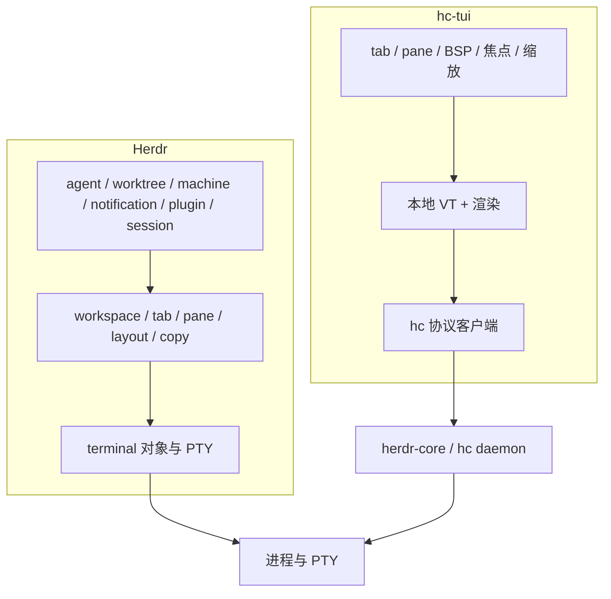

# hc-tui 与 Herdr 的差距

日期：2026-11-04
对照对象：`herdr 0.9.3`（含 `herdr --default-config`、`herdr api schema`、各命令组 help）与 `hc 0.1.17`（`hc schema`）。
本仓库基线：`a5c62ce` 之上的 P2 状态，`cargo test` 36 单元 + 2 端到端全绿。

---

## 0. 两边的层次

- herdr 在终端之上独立拥有一整套对象模型与服务端 API（`herdr api schema` 列出 **102 个方法**）。
- 本轮之前 hc-tui 只用到 herdr-core 的 32 个方法中的 4 个（`hello`、`terminal.run`、`terminal.attach`、`events.subscribe`）；现在用到 8 个（另加 `terminal.label`、`terminal.kill`、`doc.get`、`doc.set`）。
- 因此差距的主体在「客户端自有的对象模型与交互」，协议层已经基本对齐。

---

## 1. 当前已有的部分

| 能力 | hc-tui 现状 |
|---|---|
| 帧编解码、单 reader 按帧序分发 | 有 |
| credit 回还（含 events 流） | 有 |
| attach / detach / 断线退避重连 / 换新 shell | 有 |
| 本地 VT（宽字符、真彩、反显、光标、鼠标、bracketed paste） | 有 |
| BSP 分屏、焦点按几何移动、比例调整、缩放 | 有 |
| 多 Tab、Tab 栏、鼠标点选 | 有 |
| 侧栏（只读终端列表 + 状态图标） | 有 |
| 滚轮滚动本地历史 | 有 |
| 透传查询的否定应答（kitty graphics） | 有 |

---

## 2. 差距矩阵

「缺口」列只写 hc-tui 没有的部分；「依赖」列写补齐所需的接口。

### 2.1 终端对象

| 能力 | herdr | hc-tui | 缺口 | 依赖 |
|---|---|---|---|---|
| 终端列表 | `pane.list` / `session.snapshot` | 只在连接时取一次快照，之后按事件增量 | 无主动刷新、无过滤、无排序 | `terminal.list` |
| 内容读取 | `pane.read`（visible/recent/recent-unwrapped/detection，text/ansi） | 无（要看屏幕只能 `hc read`） | UI 内查看任意终端屏幕、导出 ANSI | `terminal.read` |
| 改标签 | `pane.rename` / `terminal.label` | 无 | Tab/Pane 无法命名，标题只能跟随程序 | `terminal.label` |
| 结束程序 | `pane.close` / `agent` 退出 | 无（只有 `hc kill`） | UI 内 Kill，且当前连确认都没有 | `terminal.kill` |
| 删除记录 | — | 无 | 已结束终端无法从列表移除 | `terminal.rm` |
| keep 开关 | 有（恢复策略） | 无 | 无法在 UI 里切换「丢失后补 shell」 | `terminal.keep` |
| 给程序发文本 | `pane.send_text` / `pane.run` | 无 | 无法从 UI 给 Agent 发一条消息 | `terminal.send` |
| 发命名键 | `pane.send_keys` | 无 | 无法脚本化按键 | `terminal.keys` |
| 等待条件 | `pane.wait_for_output`（match/regex/timeout） | 无 | 无法「等它打印 X」 | `terminal.wait` |
| 前台程序信息 | `pane.process_info` | 忽略 `foreground` 事件 | Pane 边框不显示当前程序 | 事件已有 |

### 2.2 布局对象

| 能力 | herdr | hc-tui | 缺口 |
|---|---|---|---|
| Workspace | `workspace.create/list/get/focus/rename/move/close`，带 label、cwd、group、git 分支与状态 | 无（只有一个隐式工作区） | 整个概念缺失 |
| Tab | `tab.create/focus/rename/move/close`，可命名、可重排 | 新建/切换/关闭 | 命名、重排、跨工作区移动 |
| Pane 交换与移动 | `pane.swap`、`pane.move`（换 tab、提成新 tab / 新 workspace） | 无 | 只能 split 后关掉重建 |
| 布局导出/应用 | `layout.export`、`layout.apply`、`layout.set_split_ratio` | 比例调整（前缀 `r`） | 无导出/导入/模板 |
| 分隔线样式 | `pane_borders`（auto/always/off）、`pane_gaps`、`pane_outer_borders` | 固定全边框 | 无配置，无 tmux 风格内分隔 |
| 滚动条 | `pane_scrollbars`、`mouse_scroll_lines` | 无 | 无滚动条，滚轮步长写死 3 |
| 清除与编辑历史 | `pane.clear`、`pane.edit_scrollback`（交给 `$EDITOR`） | 无 | 无 |
| 窄屏布局 | `mobile_width_threshold` 单列布局 | 无 | 窄终端下侧栏直接隐藏 |

### 2.3 Agent（产品定位的核心）

| 能力 | herdr | hc-tui | 缺口 |
|---|---|---|---|
| 状态识别 | `agent.list/get`，状态 `idle/working/blocked/done/unknown` + `state_change_seq` / `completion_seq` | 把 `status` 事件翻成侧栏图标 | 仅此一行代码，语义未建模 |
| 完成未读 | `completion_seq` 与每客户端 seen；Done 徽标各客户端独立 | 无 | 不消费 `turn` 事件，没有 seen 状态 |
| 注意力队列 | `agent_panel_sort = "priority"` / `status_indicators = "dots|symbols"` | 无 | 列表按终端地址排，不按注意力 |
| 跳转与 attach | `agent.focus`、`agent.attach --takeover` | 无 | 侧栏不可点 |
| 给 Agent 派任务 | `agent.prompt --wait --until`，含 bracketed paste 与「必须出现 working/blocked」闸门 | 无 | 无 |
| 启动 Agent | `agent.start --kind`，等它进入可交互状态 | 无 | 无 |
| 重命名 Agent | `agent.rename`（名字跟随 pane 占用者） | 无 | 无 |
| 解释判定 | `agent.explain` | 无 | 无法诊断「为什么判成 blocked」 |
| 会话续接 | `resume_agents_on_restore` + `agent_session` 引用 | 无 | 重启不恢复对话 |
| 声音与弹窗 | `ui.toast`（off/herdr/terminal/system）、`ui.sound`（mp3、按 Agent 静音） | 无 | 只有状态栏一行提示 |

### 2.4 复制与查看

| 能力 | herdr | hc-tui | 缺口 |
|---|---|---|---|
| Copy Mode | `pane.copy_motion`、`pane.copy_search`（进入、移动、按词/行、搜索、复制） | 无 | 只能滚轮翻 |
| 选区读取 | `pane.selection.read` | 无 | 无 |
| 拖选即复制 | `copy_on_select`、`copy_on_select` 关闭时 `Ctrl+C` 复制 | 无 | 交给宿主终端的 `Shift` 拖选 |
| 剪贴板进出 | `Ctrl+V` 图片粘贴（remote）、OSC 52 | 过滤掉 OSC 52 | 无写剪贴板、无图片粘贴 |
| 链接 | `pane.link.activate`、`pane.link.resolve`、`viewport_link_regions` | 本地 VT 已能量出链接区域，未接 | 无打开链接 |

### 2.5 配置与主题

`hc-tui` 的 `src/config.rs` 明写「首版只定义结构，文件加载在 P2 接」，实际差距：

| 能力 | herdr | hc-tui |
|---|---|---|
| 配置文件 | `~/.config/herdr/config.toml`，完整 schema | 结构体硬编码默认值，无加载 |
| 主题 | 11 个内置主题 + `[theme.custom]` 逐 token 覆盖 + 明暗自动切换 | 硬编码 `Cyan/Gray/DarkGray` |
| 键位 | `[keys]` 全部动作可绑，含 `navigate_*` 导航模式与 indexed 后缀 | 写死 14 个前缀键 |
| 自定义命令 | `[[keys.command]]` type = shell / pane / popup，带宽高 | 无 |
| 新建目录策略 | `new_cwd = follow / home / current / path` | 交给 core 默认 |
| 外壳 | `default_shell`、`shell_mode` | 交给 core 默认 |
| 确认与提示 | `confirm_close`、`prompt_new_tab_name`、`prompt_new_workspace_name` | 无 |
| 鼠标 | `mouse_capture`、`right_click_passthrough_modifier` | 恒捕获，右键无菜单 |
| 宿主光标 | `host_cursor = auto/native/drawn` | 恒用 ratatui 光标 |
| 状态栏 | `tab_bar_right` 可配 `hostname/datetime/text/command` | 固定内容 |

### 2.6 持久化与恢复

| 能力 | herdr | hc-tui |
|---|---|---|
| 会话文件 | `session.snapshot`、`sessions/*.json`、`session-snapshots/` | 无 |
| 布局持久化 | `layout.export/apply` + 服务端快照 | 无（`doc.get/set` 已实测可用，未接） |
| 跨重启恢复 | 恢复 workspace/tab/pane 与终端 | 无 |
| 历史落盘 | `pane_history`（跨完整重启保存屏幕） | 无 |

### 2.7 多机、工作树、通知、扩展

| 能力 | herdr | hc-tui | 依赖 |
|---|---|---|---|
| 多机 | `machine add/status/reconnect/enable/disable`、`--machine` 转发 | 无 | `machine.*` |
| 远程 attach | `--remote` + 托管 ssh config + 连接复用 | 无 | `machine.connect` |
| 工作树 | `worktree list/create/open/remove`（branch/base/path/trust） | 无 | git 子进程 |
| 通知 | `notification.show`、toast 四种投递、声音 | 无 | 本地 |
| 插件 | `plugin.*`、`plugin.action.invoke`、`plugin.pane.open` | 无 | 自有 API |
| 宿主集成 | `integration install`（20 种 Agent）、注入 `HERDR_*` 环境 | 无 | 无 |
| 图像 | kitty graphics 渲染、`kitty_graphics` 开关 | 只回 `ENOTSUPPORTED` | ghostty-vt 已支持 |
| 自更新与发行 | `update`、`channel`、`completion`、多平台安装包 | justfile 构建 | 无 |

---

## 3. 按代价排序的可补项

只列依赖已经具备、不需要新协议或新服务的项。

| 项 | 依赖 | 代价 | 状态 |
|---|---|---|---|
| 配置文件加载（键位/主题/边框/侧栏/鼠标/滚动/确认） | 无 | 小 | **已补** |
| Copy Mode + 选区 + 剪贴板 | ghostty-vt `read_text_viewport` | 中 | **已补** |
| Tab/Pane 重命名 | `terminal.label` | 小 | **已补** |
| Kill Terminal + 确认 | `terminal.kill` | 小 | **已补** |
| Agent 注意力队列（turn + seen + 优先级 + 点击跳转） | `status` / `turn` 事件 | 中 | **已补** |
| 布局持久化 | `doc.get/set` + CAS | 中 | **已补** |
| Workspace 概念 | 本地模型 + doc | 中 | **已补（单机、无 worktree）** |
| Pane 跨 Tab 移动 | 本地树操作 | 小 | **已补** |
| 历史落盘与恢复 | 本地文件 | 中 | 未做 |
| 通知与声音 | 本地 + `notify-send` | 小 | **部分**（toast 与系统通知，无声音） |
| 多机与远程 attach | `machine.*` + `machine.connect` | 大 | 未做 |
| 工作树 | git 子进程 | 中 | 未做 |
| 插件系统 | 自有 API 与运行沙箱 | 很大 | 未做 |

---

## 4. 结论

1. **协议与渲染层不再是瓶颈**：帧、credit、重连、VT 已过端到端门禁，剩余协议工作只有「把 33 个方法暴露到 UI」这一层。
2. **最大结构缺口是对象模型**：herdr 的 workspace / tab / pane / agent 都是有稳定 ID、可命名、可持久化、可跨机寻址的对象；hc-tui 原先只有内存里的渲染单元。
3. **第二缺口是配置与交互深度**：复制、命名、kill、确认、键位配置，是「能不能日常用」的判据。
4. **第三缺口是 Agent 语义**：`turn` 与 `status` 已经在事件流里，缺的是完成/未读模型与注意力队列。

§5 记录本轮补齐的部分；剩余顺序是 Worktree 与持久历史 → 多机与远程 → 自定义命令与插件。

---

## 5. 本轮补齐的实装与证据

### 5.1 配置与主题

- `src/config.rs`：XDG 优先的 `config.toml` 加载（TOML 子集解析）、`Keys` 全部动作可绑、
  `--default-config` 输出、`--config` 与 `--no-restore`。
- `src/theme.rs`：12 套内置主题、27 个 token、`[theme.custom]` 覆盖、`parse_color` 支持
  `#rgb` / `#rrggbb` / `rgb()` / 具名色 / `reset`。
- 证据：隔离 `XDG_CONFIG_HOME` 下写入 `theme.name = "gruvbox"` 与
  `[theme.custom] accent = "#55aa77"`，tmux 抓到的绘制序列是 `48;2;40;40;40`、
  `48;2;250;189,47`、`48;2;85;170;119`；`new_tab = "prefix+t"` 生效。

### 5.2 Copy Mode 与剪贴板

- `src/copy.rs`：视口坐标光标、词/行/页移动、搜索与 `n`、锚点选区。
- 复制路径直接取本地 VT 文本（`TerminalView::selection_text`），软换行会被拼回。
- `src/clipboard.rs`：OSC 52 与 `wl-copy` / `xclip` / `xsel` / `pbcopy` 双路，状态栏报结果。
- 证据：`prefix [` → `g` `j` `0` `v` `l`×4 `y`，状态栏「已复制 4 字符 · OSC 52」，
  取到的文本是 `/tmp`。

### 5.3 对象模型、Workspace 与跨 Tab 移动

- `src/model.rs`：`Workspace → Tab → Pane`，Pane 跨 Tab 移动 ID 不变、attach 流不断；
  `SavedState` 只存结构、终端地址与名字，不存屏幕内容。
- 键位：`prefix shift+n` 新工作区（先问名字）、`prefix w` 选择器、`prefix shift+x` 关闭；
  `prefix m` 后接 `1-9` 把当前 Pane 移到目标 Tab，接 `t` 移成新 Tab。
- 证据：两个 Tab 时 `prefix m` `1` → 源 Tab 消失、目标 Tab 变成左右两个 Pane，
  焦点落在被移动的 Pane 上。

### 5.4 布局持久化

- `doc.get` 在连接建立后立即读取 `hctui-layout-v1`；`doc.set` 带版本号，400 ms 防抖，
  `conflict` 时先 `doc.get` 取最新版本再重放本地意图。
- 恢复时 Pane 重新编号、按 `terminal` 地址重新 attach；终端不存在时沿用网络层的换新 shell。
- 证据：新建 2 个 Tab + 分屏后退出，重新启动得到 3 个 Tab 与同一棵分屏树，
  两个 Pane 分别重新 attach 到 `t1` / `t4`；工作区名 `api`、Tab 名 `work` 一并恢复。

### 5.5 Agent 注意力队列

- `status` / `turn` 事件进入 `Agent { status, turn, seen_turn }`；`idle|done` 且有未读
  `turn` 时徽标为 `done`。焦点或可见性到来时标记已读。
- 侧栏按 `blocked > error > done > working > idle` 排序，工作区行带待处理计数。
  `prefix a` 跳到最需要处理的一个。
- 后台完成时按 `notifications.delivery` 发 toast 或 `notify-send`，右下角弹出。
- 证据：在 Tab 2 用 `hc send` 让 Tab 1 的终端上报 `state=working` → `state=idle`（`turn=1`），
  右下角出现 `… · done` toast、状态栏提示待处理；`prefix a` 跳回 Tab 1 后徽标回到 `idle`。

### 5.6 仍然欠缺的，按能力归属拆开

`hc schema` 的 32 个方法与 vendored crate 已经覆盖了大部分「herdr 有而这里没有」的项，
所以下面的「缺」多数是接线，不是 core 能力缺口。

**A. core 已提供，客户端未接**

| 能力 | core 方法 | 状态 |
|---|---|---|
| UI 内读屏、发键、等输出、发文件 | `terminal.read` / `keys` / `wait` / `put` | 已接 |
| 多机与远程 attach | `machine.add/list/connect/rename/rm`、`terminal.run --on` | 已接 |
| keep 开关、清理已结束终端、模板 | `terminal.keep` / `rm` / `templates.list` | 已接 |
| 一次性远程命令 | `machine.exec` | 未接 |
| 过滤订阅 | `events.subscribe` 的 `terminal` / `children_of` / `label` | 保留全量（侧栏要看全部终端） |
| 文件读写与精确替换 | `file.read` / `write` / `edit` | 客户端自身不需要 |

**B. 原语已具备，差客户端实现**

| 能力 | 已有什么 |
|---|---|
| Kitty Graphics 渲染 | crate 的 `KittyImagePlacement` / `KittyImageDescriptor`，core 转发序列 |
| 滚动条 | `Terminal::scrollbar()` |
| 历史编辑（`$EDITOR`）与 ANSI 导出 | `read_ansi_viewport` / `read_ansi_screen`、`terminal.read` |
| 链接激活 | `viewport_link_regions` / `viewport_hyperlink_uri` |
| 图片粘贴 | 本地剪贴板 + attach；`terminal.put` 发文件 |
| 自定义命令（shell / pane / popup） | `terminal.run` 任意 argv；popup 是渲染层 overlay |
| 声音 | 客户端调用系统播放器 |
| Worktree | git 子进程（core 不参与） |

### 5.7 第二批：命令、动作与状态

| 项 | 实装 |
|---|---|
| 自定义命令 | `[[keys.command]]`（数组表解析）、`shell` / `pane` / `popup` 三种执行层；临时 Pane 在程序退出后自动折叠；popup 尺寸支持格数与百分比 |
| 给程序发消息 | `prefix i` → `terminal.send`（弹出输入行，支持光标编辑与历史） |
| 中断当前轮 | `prefix shift+c` → `terminal.interrupt` |
| keep / rm | `prefix shift+o` / `prefix shift+u` |
| 打开链接 | `prefix o` 与 Copy Mode 的 `o`（`viewport_hyperlink_uri`） |
| 历史交给编辑器 | `prefix shift+e`：`read_ansi_viewport` 写临时文件，在 popup 里用 `$EDITOR` 打开 |
| 滚动条 | `Terminal::scrollbar()` 画在焦点 Pane 右缘 |
| Copy Mode 补全 | 矩形选区（`R`）、搜索命中高亮、软换行按视口文本拼接 |
| 侧栏 | 滚轮滚动、没有状态上报的 Pane 也列出、超出高度显示位置 |
| 已读状态落盘 | `~/.local/state/hc-tui/state.json`，重启后不把旧完成当新完成 |
| doc 并发 | 监听 `doc` 事件并刷新版本号；`conflict` 时取最新版本后重放本地意图 |
| 断线重放 | 连接层失败的 RPC 进入队列，重连 `hello` 后按原参数重发 |

验证：`cargo test` 65 单测 + 2 端到端全绿，`clippy -D warnings` 干净；tmux 实机确认
popup（`less`）、临时 Pane 自动消失、`shell` 命令落盘、`terminal.send` 回执、
keep 写入 core、rm 后 `hc ls` 为空、滚动条与侧栏滚动、`prefix shift+e` 打开编辑器。

### 5.8 第三批：剩余接线、原语与发行

| 项 | 实装 |
|---|---|
| 读屏 | `prefix /` 打开只读浮层（`terminal.read`，含 `how` / `complete`，可滚动） |
| 按键与等待 | `prefix shift+i`（`terminal.keys`）、`prefix shift+w`（`terminal.wait --output`） |
| 发文件与图片 | `prefix shift+p`（`terminal.put`）、`prefix shift+v`（剪贴板 PNG → `terminal.put` → 贴回路径） |
| 模板 | `prefix shift+t`：`templates.list` 选择器，选中后在新 Tab 里 `terminal.run` |
| 多机 | `prefix shift+m`：机器选择器；`n`/Enter 用 `terminal.run --on` 开远程 Pane，`a`/`c`/`r`/`d` 走 `machine.add/connect/rename/rm`；侧栏显示机器状态 |
| 图形 | 启用 libghostty 的 kitty graphics，查询由本地 VT 回答；非虚拟 placement 采样成单元格背景（RGB/RGBA/PNG） |
| 声音 | `[notifications] sound` + 三个路径，`paplay`/`ffplay`/`afplay`/`mpv` 依次尝试，兜底响铃 |
| Tab 栏命令 | `tab_bar_right` 支持 `cmd:<shell 行>`，每 5 秒后台跑一次取首行 |
| 侧栏折叠 | `sidebar_collapsed_mode = compact/hidden`，窄栏显示各工作区待处理数 |
| 宿主光标 | `host_cursor = native/drawn` |
| 发行 | `just release-musl`（cargo-zigbuild）产出静态链接二进制；`just dist` 生成 checksum；本机已构建并验证 `hc-tui-x86_64-unknown-linux-musl`（4.6 MB, statically linked）；CI musl 任务改为阻塞 |
| 冒烟 | `scripts/ui-smoke.sh` + `just smoke`：首次绘制、Tab/分屏、跨重启恢复、Copy Mode、reader、三种自定义命令 |

仍未接：`machine.exec`、订阅过滤（保留全量订阅以便侧栏看到其它客户端的终端）、
kitty 虚拟 placement、macOS 产物（需 macOS runner）。

**C. core 确实不提供（优先级已下调）**

1. 插件系统与插件沙箱。
2. Agent 会话续接（依赖各家 `integration install` 钩子与它自己的 session 引用）。
3. Worktree（git 子进程即可，暂缓）。
4. 发行：linux-musl 静态、macOS aarch64、checksum、自更新。

下调后的开工顺序：core 接线（`terminal.read/send/keys`、`machine.*`、keep/rm、订阅过滤）→
实装债务（doc 并发、`seen_turn` 落盘、断线重放文字、侧栏滚动）→ 原语（滚动条、链接、图形）→
自定义命令 → 上述暂缓项。
