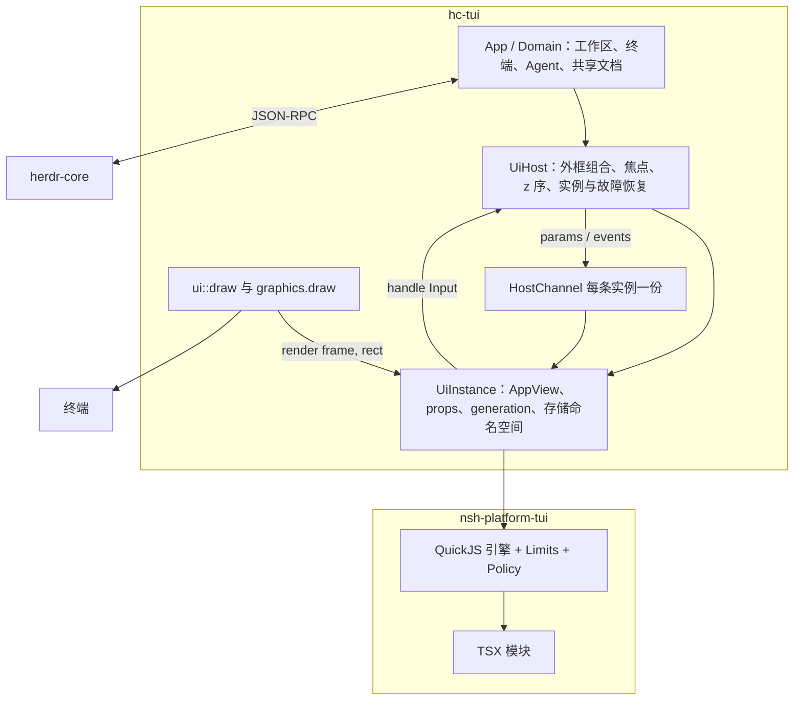
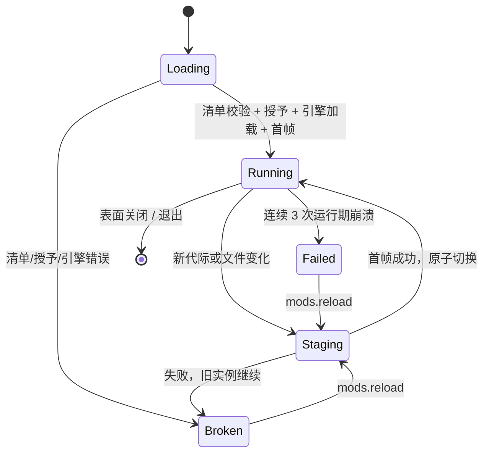

# 界面模块（mods）集成规格 v0.4

[返回 README](../README.md) · [配置](configuration.md) · [命令](commands.md) · [插件](plugins.md) · [开发计划](plan-extensions.md) · [开发与部署](development.md)

版本：v0.4（2026-11-06）
状态：实施中。外框与表面（§4、§5 宿主侧、§6 结构、§12 schema 4）随 M3 落地；宿主通道、实例生命周期、覆盖层与键鼠粘贴路由（§5 预算调度、§6 表面分支、§7–§9、§11）随 M4 落地；安装、代际、签名包与 `mods` CLI（§10、§12、§13）随 M5 落地，示例见 `examples/mods/`。逐项进度见 [开发计划](plan-extensions.md#31-里程碑交付状态)。
取代：本文 v0.3。
运行时基线：nsh 提交 `951556dc1af6f5acf593cfd28640a0fd467b71e3`（`crates/nsh-platform-tui`、`crates/nsh-tui-host`）；发行版 0.4.0 尚无 TUI 后端。宿主侧 ratatui 0.30.2、crossterm 0.29。

---

## 1. 定位

界面模块（下称 mod）是 TSX 应用，由 hc-tui 在自己的帧里嵌入运行。hc-tui 负责外框组合、表面矩形、输入仲裁、数据与动作；nsh 负责表面内部的布局、组件、动画、键鼠、文本输入、沙箱与权限。

默认界面由 8 个内置模块组成：`sidebar`、`tabs`、`status`、`picker`、`dialogs`、`settings`、`help`、`toast`，共享 `ui-base` 组件库。它们随二进制分发，默认外框绑定它们；Rust 实现保留为 `--no-mods` 与单个模块禁用时的回退。用户模块通过显式绑定替换区域、占用 Pane 或以覆盖层出现，不能在加载时自行占据全屏或改写默认界面。



所有权划分：

| 层 | 持有 | 不持有 |
|---|---|---|
| App / Domain | 工作区、终端、Agent、共享文档、连接 | 模块实例与界面状态 |
| UiHost | 外框树、区域矩形、焦点、z 序、实例注册、授予、恢复 | 业务事实、PTY |
| UiInstance | 一个 `AppView`、props、generation、存储命名空间、生命周期 | 其它实例或 App 的可变引用 |
| TSX 模块 | 局部交互状态、展示逻辑、异步请求 | 终端、布局树、共享文档写入 |

能力边界：

| 能做 | 不能做 |
|---|---|
| 停靠区、Pane 内视图、dialog / popup / window 覆盖层 | 模块加载时自动替换默认界面；跨实例绘制 |
| CSS 弹性布局、组件库、动画、输入控件、菜单与浮层 | 图片、视频、webview（TUI 后端省略）；Canvas 仅 braille；每格一种颜色 |
| 读取规范化快照、执行动作、执行命令与读写文件、发通知 | 修改共享布局文档、新增 core 方法、持有 App 可变引用 |
| 按声明授权，超时与内存受限，热重载与版本化存储 | 系统窗口、标题栏按钮、字体选择、OS 级沙箱 |

停靠区、外框与覆盖层只影响本地屏幕，不写入 `herdr-app` 与 `hctui-layout-v1` 文档。

## 2. 依赖与构建

| 项 | 内容 |
|---|---|
| 界面运行时 | `nsh-platform-tui`，固定提交；`default-features = false` 并启用 `js`；开发宿主另开 `dev` |
| 宿主接口 | `nsh-engine`：`Bundle`、`Policy`、`HostChannel`、`Limits`、`AppError` |
| 渲染 | `ratatui = "0.30.2"`、`crossterm = "0.29"`；0.30 把 `Frame`、`Rect`、`Buffer` 从 `ratatui-core` 再导出，与 `AppView::render` 同一类型 |
| Rust | nsh 使用 edition 2024，工具链需要当前 stable |
| 目标平台 | Linux musl 静态与 macOS 沿用 `cargo-zigbuild`；QuickJS 为 C 源码，随构建编译 |
| 第三方声明 | nsh（Apache-2.0）、QuickJS 与 nsh 传递引入的解析、排版、图形依赖 |

构建顺序：先完成 ratatui 0.30 与 crossterm 0.29 的迁移并让现有 UI 测试、真实字节回放测试与图片遮挡测试通过，再引入 nsh 依赖。迁移涉及 `src/ui/`、`src/tui.rs`、`src/term/input.rs`、`src/app.rs` 的事件与鼠标坐标，主要是导入路径与少量 API 名称。

## 3. 目录与清单

```
ui/                             仓库内的默认模块源码
  ui-base/                      共享组件库：主题、列表、徽章、按键提示
  sidebar/ tabs/ status/        常驻区域模块
  picker/ dialogs/ settings/    按需浮层模块
  help/ toast/

~/.config/hc-tui/mods/<name>/   用户模块与克隆的默认模块
  nsh.json          nsh 应用元数据与 capabilities
  App.tsx           入口
  hctui.toml        挂载、授予与宿主接口版本
  assets/           图标、主题、静态资源
  dist/             nsh build 产物：字节码、capabilities.json、资源
```

安装后由存储层管理代际：

```
~/.local/state/hc-tui/mods/
  store/builtin/<hc-tui 版本>/  内置模块的 bundle，随二进制解出
  store/<id>/<generation>/     安装的代码与 dist/
  current/<id> -> store/<id>/<generation>
  records/<id>.json            来源、清单哈希、启用状态、代际
  grants/<id>.json             无窗口时写入的授予
  data/<id>/                   AppOptions.data_dir，包级持久状态
  local/<id>/<surface>/        StorageBackend，实例级持久状态
  logs/<id>/                   引擎日志与错误（两份各 1 MiB）
  trust/nsh-trust.json         已接受的撤销序列与每个 app 的最高构建号
```

### `hctui.toml`

```toml
[mod]
id = "agents"                     # 默认目录名
title = "Agents"
place = "right"                   # left | right | top | bottom | none
size = 320
focusable = true
host_api = 1
min_hc_tui_version = "0.5.0"      # 可选

[overlay]                         # 可选；place = none 或显式打开时使用
kind = "popup"                    # dialog | popup | window
width = 640
height = 0.8

[grants]
host = ["state", "run", "exec", "files", "notify", "overlay", "theme", "order"]
events = ["state.changed", "terminal.status", "terminal.turn", "focus.changed", "theme.changed", "props.changed", "command"]
```

| 字段 | 说明 |
|---|---|
| `place` | 默认表面类型与位置；`none` 只由 `mods.open`、外框绑定或其它 mod 打开 |
| `size` | 停靠厚度；小于等于 1 视为占比，否则为像素 |
| `focusable` | 允许 `pane.go` 把键盘焦点移入该表面 |
| `host_api` | 宿主通道版本；与内嵌版本不符时拒绝加载 |
| `[grants] host` | 允许调用的宿主方法名，未列出的一律拒绝 |
| `[grants] events` | 允许接收的事件名，未列出的不投递 |
| `min_hc_tui_version` | 与 hc-tui 版本比较，不满足时跳过并给警告 |

### `nsh.json`

沿用 nsh 字段：`name`、`id`、`version`、`build`、`schemes`、`icon`、`appearance`、`theme`、`capabilities`。`capabilities` 由 nsh 引擎强制执行，覆盖 `network`、`fs`、`process`、`webview`、`clipboard`、`notifications`、`openUrl`、`picker`、`speech`、`audio`。

## 4. 外框与表面

外框（chrome）是本机配置，描述区域树；与共享 Pane 树分开。

```json
{
  "schema_version": 1,
  "root": {
    "type": "row",
    "children": [
      { "type": "block", "id": "left", "size": { "cols": 26 }, "content": { "builtin": "spaces" } },
      { "type": "column", "children": [
        { "type": "block", "id": "top", "size": { "rows": 1 }, "content": { "builtin": "tabs" } },
        { "type": "block", "id": "content", "content": { "content": "panes" } },
        { "type": "block", "id": "bottom", "size": { "rows": 1 }, "content": { "builtin": "status" } }
      ] }
    ]
  }
}
```

- 节点类型：`row`、`column`、`block`；`block` 的内容是 `{"builtin":"spaces"|"tabs"|"status"}`、`{"mod":"agents","props":{}}` 或 `{"content":"panes"}`。
- 恰好一个 `panes` 叶子，终端尺寸只由它决定；不允许两个区域同时竞争同一组终端。
- 尺寸用字符格或比例；最小宽度与最小高度不足时按现有规则折叠，模块区域在折叠时不渲染。
- 默认外框绑定内置模块。替换某个区域需要显式绑定：`mods.dock`、配置文件或 `mods.chrome` 动作；模块自身不能声明占据哪个区域。
- 外框保存在本地 state 的 `mods_chrome`，不写共享文档；GUI 侧看不到 TUI 的模块区域。

表面类型：

| 类型 | 来源 | 行为 |
|---|---|---|
| `region` | 外框 `mod` 块 | 占该区域，参与折叠与 resize |
| `pane` | `mods.open --place pane` | 占一个 Pane 位，参与分屏、Stack、浮动与 zoom |
| `overlay` | `[overlay]` 或 `mods.open --place dialog/popup/window` | 内容区之上的独立表面，按 z 序绘制 |

覆盖层：`dialog` 居中并由宿主压暗内容区；`popup` 靠近指针或指定位置；`window` 可拖动、记忆位置，`key` 相同复用同一位置，`keep = true` 下次启动重开。覆盖层不接收内容区的鼠标事件。

## 5. 渲染与帧循环

`ui::draw` 的顺序：

1. 绘制外框内置区域（侧栏、Tab 栏、模式行）。
2. 绘制外框中的模块区域：`view.render(frame, rect)`。
3. 绘制内容区 Pane（现有路径不变）。
4. 按 z 序绘制覆盖层表面。
5. 显示光标：取焦点表面的 `cursor_style()`，在对应矩形内定位。

`graphics.draw` 在字符帧之后输出 Kitty 图片，必须把模块区域与覆盖层并入遮挡计算：与遮挡矩形相交的图片不输出，覆盖层关闭后重新上传；裁剪按 Pane 与表面矩形的交集计算。遗漏这一步会让终端图片盖住 dialog。

调度：

- 引擎在后台线程提交变更，`WakeCallback` 只置原子脏标记，不触碰 App 状态。
- 每轮循环取 `app.wake_at()`、`config.render_fps` 与各表面 `next_frame_deadline()` 的最早时间；没有待办时不重绘。
- 一帧内所有表面 `render` 总预算 32 ms，单表面 8 ms；超出的表面保留上一帧并记账。
- `frame_metrics()` 与 `FrameMetrics` 记录提交、布局、挂载耗时，写入 mod 日志并接入现有诊断输出。
- nsh 的焦点切换有追赶等待（约 100 ms），输入路径不能宣称完全非阻塞；基准测试覆盖快速焦点切换与高负载。

## 6. 输入与焦点

宿主保有终端所有权：不运行抢占 TTY 的独立宿主，不让模块设置 raw mode、写 stdout 或更改鼠标协议。

路由顺序：

1. 前缀键与紧急恢复键优先；连按两次前缀把字面前缀交给当前输入目标（终端或模块表面）。
2. 有模态时只向顶层模态投递普通输入。
3. 模块表面有焦点时，普通按键、粘贴与鼠标交给该 `AppView`；`Handled::Ignored` 的按键只落到已显式绑定的宿主命令，不自动送进后台 PTY。
4. 终端有焦点时走现有路径；模块不旁听原始终端输入。

| hc-tui 事件 | nsh 输入 |
|---|---|
| `KeyEvent` 按下 / 重复 | `Input::Key { key, modifiers, release: false }` / `Input::KeyRepeat` |
| `KeyEvent` 释放 | `Input::Key { release: true }` |
| `Event::Paste` | `Input::Paste` |
| 终端获得 / 失去焦点 | `Input::Focus(bool)` |
| 鼠标按下 / 释放 / 移动 / 滚轮 | `Input::Mouse(MouseInput { kind, column, row, modifiers })` |

- 坐标为终端绝对列行，nsh 按表面矩形换算。
- `set_focused(bool)` 标记焦点表面；`focusable` 的区域按外框顺序并入 `pane.go` 循环。
- 模块内部的 Tab 导航由 nsh 处理；离开模块用宿主命令（`pane.go` 或绑定动作）。
- `Ctrl+B` 在模块文本输入中仍先被前缀消费；连按两次把字面 `Ctrl+B` 交给表面。
- 鼠标按 z 序选择表面；拖动目标从按下到释放保持不变；覆盖层内操作不穿透。
- `Esc` 关闭顶层 dialog 或 popup；`window` 由自身控件关闭。
- `<mod>.<command>` 通过 `host.on("command", { name, args })` 投递，命令面板、`[[keys.command]]` 与 `hc-tui do` 都能触发。

## 7. 宿主通道

每条实例一份 `HostChannel`。启动参数同步可见；事件在被监听前保留在 nsh 队列中，超过队列上限的最旧事件被丢弃。

### 启动参数 `host.params`

```json
{
  "mod": "agents",
  "surface": "s3",
  "generation": 4,
  "place": "region",
  "props": {},
  "space": { "id": "sp1", "name": "api", "machine": "peer", "folder": "/srv/api" },
  "tab": { "id": "tb1" },
  "pane": { "id": "7", "terminal": "peer/t7" },
  "machine": { "client": "box", "core": "box", "workspace": "peer" },
  "cell": [8, 16],
  "locale": "zh",
  "theme": { "name": "catppuccin", "tokens": {}, "palette": [] },
  "api": { "host": 1, "hc_tui": "0.5.0" }
}
```

`machine` 区分三个位置：`client` 是 hc-tui 进程所在主机，`core` 是当前连接入口，`workspace` 是本 Space 的机器。模块进程与 nsh `fs` 能力都在 `client`；工作区操作通过宿主方法携带 `on` 路由。

### 快照与变更

`host.call("state", { domains?, space? })` 返回：

```json
{
  "generation": 4,
  "revision": 812,
  "connection": "ready",
  "machines": [],
  "spaces": [],
  "tabs": [],
  "panes": [],
  "agents": [],
  "terminals": [],
  "focused": {},
  "theme": {}
}
```

- `revision` 在任何被订阅的数据变化时递增。
- `state.changed` 的负载是 `{ revision, domains }`，不带差异补丁。
- 模块记录 `revision`；发现跳号或断线重连后重新调用 `state`，不按事件逐条重放。
- 读取领域由模块显式请求；宿主不追踪每次读取的依赖，也不因模块未读而停发事件。
- 目标在请求时冻结：`run` 与文件方法使用调用时解析出的稳定 ID 与机器，后续焦点变化不影响。
- 对象已删除返回 `target_gone`；断线与机器不可达返回 `unavailable`，不在另一台机器执行。

### 事件 `host.on(name, listener)`

| 事件 | 负载 |
|---|---|
| `state.changed` | `{ revision, domains }` |
| `terminal.status` | `{ address, machine, status, app, title, cwd, seq, revision }` |
| `terminal.turn` | `{ address, turn, revision }` |
| `terminal.title` | `{ address, title, revision }` |
| `terminal.finished` | `{ address, program_exit, revision }` |
| `focus.changed` | `{ space, tab, pane, terminal }` |
| `theme.changed` | `{ name, tokens, palette }` |
| `props.changed` | `{ props }` |
| `command` | `{ name, args }` |
| `grant.changed` | `{ grants }` |
| `action.finished` | `{ request, status, error? }` |
| `app.ready` | `{ revision }`，首次连上 core 或重连完成后投递 |

### 调用 `host.call(name, data)`

| 方法 | 授予 | 参数 | 返回 |
|---|---|---|---|
| `state` | `state` | `{ domains?, space? }` | 见上，panes 上限 512 |
| `run` | `run` | `{ name, args }` | `{ request, accepted, confirmation_pending }` |
| `request` | `run` | `{ request }` | `{ status: "accepted"｜"confirmation"｜"running"｜"done"｜"failed"｜"conflict", error? }` |
| `exec` | `exec` | `{ argv, cwd?, on?, env?, timeout_s? }` | `{ code, stdout, stderr, timed_out, truncated }`，30 秒、8 MiB |
| `readFile` | `files` | `{ path, cwd?, on?, max_bytes? }` | `{ data, truncated }`，1 MiB |
| `writeFile` | `files` | `{ path, data, cwd?, on?, expected? }` | `{ written }`，1 MiB |
| `notify` | `notify` | `{ title, body?, level?, timeout? }` | `{ id }` |
| `theme` | `theme` | `{}` | `{ name, tokens, palette }` |
| `overlay` | `overlay` | `{ mod?, props?, kind, width?, height?, at? }` | `{ surface }` |
| `closeOverlay` | `overlay` | `{ surface }` | `{}` |
| `focus` | `overlay` | `{ surface }` | `{}` |
| `surface` | 无 | `{}` | `{ id, generation, place, cols, rows }` |
| `setAgentOrder` | `order` | `{ addresses }` | `{}` |
| `requestGrants` | 无 | `{ grants }` | `{ granted }`，触发授予流程 |

- `run` 的 `request` 由宿主生成；`accepted` 只表示动作已被受理。完成状态通过 `request` 查询或 `action.finished` 事件得到；`confirmation_pending` 表示仍需用户在界面确认。
- 所有回复带 `generation`；与当前实例不符的迟到回复由宿主丢弃，模块也应忽略。
- 错误统一为 `{ code, message }`：`forbidden`、`offline`、`unavailable`、`target_gone`、`not_found`、`invalid`、`timeout`、`busy`、`conflict`、`staging`。
- `exec` 单表面并发上限 4 条，超出返回 `busy`；默认 `cwd` 与 `on` 取启动参数里的 `folder` 与 `workspace`，显式值优先。
- 未授予的方法返回 `forbidden`，不产生副作用。

## 8. 权限与安全

| 层 | 声明位置 | 执行者 | 内容 |
|---|---|---|---|
| nsh 能力 | `nsh.json` 的 `capabilities` | nsh 引擎 | 网络主机与端口、文件读写路径、可执行程序、环境变量、剪贴板、通知、打开 URL、选择器 |
| 宿主授予 | `hctui.toml` 的 `[grants]` | hc-tui | 上表全部方法与 12 个事件名 |

- 加载时计算 `needed = 声明的 nsh 能力 ∪ 宿主授予`；与上次批准不一致时弹出确认，逐项可拒绝；结果存 `state.json` 的 `mods_grants`。
- 引擎的 `Policy { declared, granted }` 用批准后的集合收窄；宿主方法在 hc-tui 侧再次校验，未授予返回 `forbidden`。
- `requestGrants` 可在运行期申请新增授予，同样走确认流程。
- nsh 能力与宿主授予描述依赖与路由范围，不构成对恶意代码的 OS 隔离：`process.execute` 能绕过文件写入路径的限制，网络与执行权限按用户身份生效。信任边界是安装来源、安装前预览与签名包的信任根。
- 本地目录中的 mod 属于用户自己编写的可信代码；共享文档或 GUI 中的模块引用不自动获得执行权。
- 沙箱限制：内存 128 MiB、调用 500 ms、加载 10 s、节点数 200000，按实例设置，`hctui.toml` 只能下调。
- 日志与错误写 `logs/<id>/`，保留两份各 1 MiB；失败表面顶部标注原因，其它表面不受影响。

## 9. 主题

hc-tui 的 token 表供给三处：`TerminalCapabilities`（背景与前景色、色深、Command 键）、启动参数与 `theme` 事件、内置界面自身。

| hc-tui token | 用途 |
|---|---|
| `bg` | `TerminalCapabilities.background_color` |
| `fg` | `TerminalCapabilities.foreground_color` |
| `dim` | 次要文字 |
| `border` / `border_focused` | 边框与聚焦边框 |
| `accent` | 强调色 |
| `sidebar_bg` / `sidebar_selected_bg` | 卡片与选中行 |
| `selection_bg` / `selection_fg` | 选区 |
| `agent_blocked` / `agent_error` / `agent_working` / `agent_done` / `agent_idle` / `agent_unknown` | 状态色 |
| `terminal_palette()` 的 16 色 | `theme.palette` |

色深按终端能力选择 `TrueColor` / `Ansi256` / `Ansi16` / `Monochrome`；`NO_COLOR` 时进入 `Monochrome`，状态用反显、加粗、下划线表达。终端 OSC 10/11 已报告默认色时以终端值为准。

## 10. 打包与分发

| 场景 | 命令 | 说明 |
|---|---|---|
| 本地开发 | `nsh init`、`nsh run --target tui` | 独立宿主里预览与热重载 |
| 本地构建 | `nsh build -o dist --release` | 字节码、`capabilities.json` 与资源 |
| 类型与单测 | `nsh check`、`nsh test` | `check` 会从 npm 取 TypeScript；`test` 每个用例独立引擎 |
| 第三方分发 | `nsh publish` | 生成签名 `.nshpkg`；`keygen`、`certify`、`verify`、`revoke` 沿用 nsh 工具 |
| 安装 | `hc-tui mods install <目录或 .nshpkg>` | 预览清单与能力后写入新代际并启用 |
| 开发链接 | `hc-tui mods link <目录>` | 符号链接；清单变化后重载，不产生新代际 |
| 更新 | 重新 `mods install` | 写入新代际，`current` 原子切换；运行中的实例继续用旧代际，关闭后回收 |
| 内置模块 | 随二进制 | 构建时打入 bundle，启动按 hc-tui 版本解到 `store/builtin/<version>/`；`mods clone` 可复制到配置目录修改 |

信任根写在 `config.toml` 的 `[mods] trust_roots`，撤销列表由 `nsh revoke` 生成并放在配置目录。来源分三类：`linked`（本地开发）、`local`（目录拷贝）、`packaged`（签名包，需验证）。安装前显示 id、版本、nsh 能力、宿主授予与 `min_runtime`；用户确认后才启用。

发布顺序与插件一致（同一个 `Store`）：先写 `records/<id>.json`，再切 `current/<id>`。记录是发布真相，指针切换失败时下一次 `Store::open` 按记录重建指针。

## 11. 生命周期与热重载



- 加载：解析两份清单、校验 `host_api`、`min_hc_tui_version`、nsh `min_runtime`、确认授予、`Bundle::from_path` 或 `Bundle::from_package`、`AppView::load`、首帧渲染。
- 热重载：`AppView::load` 会停止旧实例，因此新实例先在 staging 中加载并渲染到离屏缓冲区；成功后再替换旧实例并切换 `generation`。失败时旧实例与已显示帧保持不变，错误写入日志。
- staging 期间宿主方法返回 `staging`，模块不能在激活前产生不可回滚副作用；`init` 只读状态。
- 激活后旧代际的迟到回复按 `generation` 丢弃；旧代码的定时器与挂起任务随实例停止。
- 崩溃：`on_error` 与 `on_app_error` 记录并保留上一帧；连续三次失败进入 `failed`，`mods.reload` 恢复。
- 内置模块随 hc-tui 版本更新：升级后使用新版本目录，旧版本在引用释放后回收；用户克隆的副本不随升级覆盖。
- 默认界面的回退：`--no-mods` 关闭全部模块并使用内置外框；单个 mod `disable` 后其区域回到内置内容，或被显式设为 `none`；回退路径不依赖 nsh 运行时。
- 关闭：表面关闭时调用 `AppView::stop`，期限 250 ms；退出时所有表面共用该预算。

## 12. 持久化

| 位置 | 内容 |
|---|---|
| `store/<id>/<generation>/` | 安装的代码与 `dist/` |
| `records/<id>.json` | 来源、清单哈希、启用状态、代际、安装时间 |
| `data/<id>/` | 包级持久状态，`AppOptions.data_dir` |
| `local/<id>/<surface>/` | 实例级 `localStorage` |
| `logs/<id>/` | 引擎日志与错误 |
| `state.json` 的 `mods_chrome` | 外框树 |
| `state.json` 的 `mods_windows` | `window` 覆盖层位置与 `key` |
| `state.json` 的 `mods_grants` | 已批准的能力、宿主方法与事件 |
| `mods/grants/<id>.json` | 无窗口时由 `hc-tui mods grant` 写入的授予，启动时并入 |
| `trust/nsh-trust.json` | 信任根状态：已接受的撤销序列与每个 app 的最高构建号 |

`state.json` 升到 schema 4；缺失字段按空处理。运行中的表面记录其代际，代际在最后一个引用的表面关闭后回收。

## 13. 命令与 CLI

TUI 内动作：

| 动作 | 参数 |
|---|---|
| `mods.open` | `name` 必填；`props`、`place`（`pane`/`left`/`right`/`top`/`bottom`/`dialog`/`popup`/`window`）、`size` |
| `mods.close` | `name` 或 `surface` |
| `mods.reload` | 可选 `name` |
| `mods.dock` | `name`、`place`、`size`、`index`、`replace` |
| `mods.undock` | `name` |
| `mods.chrome` | `tree`，替换外框树 |
| `mods.grant` | `name`、`host`、`events`、`revoke` |
| `mods.disable` / `mods.enable` | `name` |
| `mods.clone` | `name`、`as`；把内置模块复制到配置目录 |

命令行：

```sh
hc-tui mods list [--json]
hc-tui mods check <path|id>        # 清单校验 + nsh check + 80x24 无窗口试渲染
hc-tui mods test <path|id>         # 包装 nsh test
hc-tui mods build <path|id>        # 包装 nsh build -o dist
hc-tui mods install <目录或 .nshpkg> [--yes]
hc-tui mods update <id> <目录或 .nshpkg>
hc-tui mods uninstall <id>
hc-tui mods link <目录>
hc-tui mods unlink <id>
hc-tui mods log <id> [-n 100]
hc-tui mods clone <id> [--as 名称]
hc-tui mods open <name> [--props JSON] [--place ...]
hc-tui mods close <name>
hc-tui mods reload [name]
hc-tui mods grant <id> [--host ...] [--events ...] [--revoke ...]
hc-tui mods enable|disable <id>
```

`list`、`check`、`test`、`build`、`log`、`install`、`update`、`uninstall`、`link`、`unlink`、`grant` 与 `enable`/`disable` 的持久化部分不依赖运行中的窗口；`open`、`close`、`reload`、`grant`、`enable`、`disable` 先经本地控制 socket 转发给运行中的 TUI，socket 不可用时 `grant`/`enable`/`disable` 写入 `mods/grants/<id>.json` 与 records。`check` 在 `TestBackend` 上完成首帧渲染，不触碰真实终端。`install` 显示预览后要求终端确认或 `--yes`；签名包校验失败、撤销、构建号回退与 `min_runtime` 不满足都会在安装前拒绝并说明。

## 14. 与插件、脚本面板的分工

| 层 | 位置 | 形态 | 适合 |
|---|---|---|---|
| mods | hc-tui 进程内，TSX | 外框区域、Pane 内视图、覆盖层 | 富交互界面、实时状态、列表与表单 |
| 插件 | 独立进程，清单贡献 | 一次性动作、终端面板、启动钩子 | 任意语言、远端面板、长期命令 |
| 脚本面板 | core 终端 | 定时命令输出，ANSI 文本 | 状态展示，GUI 共享的 module 节点 |

三者共用同一动作分发器、同一状态快照与控制 socket；mod 通过 `host.call("run")` 触发插件动作，插件通过 `hc-tui do`、`hc-tui read`、`hc-tui ls` 访问同一状态。模块引用插件面板时使用稳定 ID，不按名字猜测。

M6 起插件动作带 `<package-id>.<action-id>` 完整名进入同一分发器：命令目录与 `hc-tui commands` 带 `source = "plugin:<id>"`、上下文与参数 schema，命令面板与 Pane 右键菜单按 `contexts` 显示；参数 schema 与目标冻结由宿主校验，动作进程的超时、取消、进程组回收与并发队列由宿主约束。插件动作在禁用或卸载后即时从目录与菜单消失，内置动作不可覆盖。

## 15. 概念对照

| herdr-app mod | 本规格 |
|---|---|
| `spaces()`、`agents()`、`panes()`、`terminals()`、`focused()` | `host.call("state")` 加 `state.changed` |
| `run(command, args)` | `host.call("run")`，`request` 查询最终状态 |
| `exec(cmd, args, { cwd, on })` | `host.call("exec")` |
| `readTextFile` / `writeTextFile` | `host.call("readFile"/"writeFile")`；本机路径也可用 nsh `fs` 能力 |
| `watchFolder` | 用 nsh 定时器轮询 `exec` 或 `readFile` |
| `notify` | `host.call("notify")` |
| `openOverlay` / `closeOverlay` | `host.call("overlay"/"closeOverlay")` |
| `props()` | `host.params.props` 与 `props.changed` |
| `nextCommand()` | `host.on("command")` |
| `setAgentOrder` | `host.call("setAgentOrder")` |
| `theme()` | `theme` 事件与启动参数 |
| `localStorage` | nsh 存储后端，按实例隔离 |
| 默认界面由内置模块组成 | 8 个内置模块绑定默认外框；Rust 实现作为回退 |
| `herdr-app check` | `nsh check` 与 `hc-tui mods check` |

## 16. 限制清单

- TUI 后端不绘制图片、视频与 webview；Canvas 只有 braille 点阵，没有合成与图片填充。
- 每个单元格一种前景与一种背景；渐变、阴影、圆角、透明度按单元格近似。
- 默认界面由 8 个内置模块组成；Chat、Pane 装饰、终端、图形与手机单列布局仍在 Rust。
- 只有一个 `panes` 内容区；不支持多个区域同时竞争同一组终端，也不支持跨实例 portal。
- nsh 的 `Overlay` / `Menu` / `Popover` 只作用于自身矩形；跨 Pane 的全局浮层由宿主表面实现。
- 不能直接读取其它 Pane 的文本；需要时用 `process.execute` 调用 `hc read`，受 nsh 能力约束。
- 不能新增 core 方法、不能建立第二条 core 连接、不能修改共享文档。
- 插件与 mods 的生命周期都跟随 hc-tui 客户端；detach 后都不运行。
- 不承诺 GPUI mods 源码兼容；TSX 界面需按终端习惯重新布局与裁剪。

## 17. 验收

- `examples/mods/` 提供三个示例：`agents`（区域替换，列表与跳转）、`spaces`（外框左侧，状态点与折叠）、`prs`（覆盖层，`exec` 拉取远端数据）。
- `hc-tui mods check examples/mods/*` 与 `nsh test` 全部通过。
- 数据一致性：示例列表与内置侧栏逐项相等；`setAgentOrder` 改变 `agent.next` 顺序；`revision` 跳号后重新取快照。
- 交互：点击、右键、滚轮、输入与粘贴、菜单与浮层、覆盖层拖动与 `key` 记忆、焦点在 Pane 与表面之间往返、前缀与双前缀、`Ctrl+B` 在文本输入中的行为。
- 授予：拒绝 `exec` 后调用返回 `forbidden` 且无副作用；`requestGrants` 触发确认；重启后保留批准。
- 隔离：JS 异常、超内存、超调用时间各触发一次，只有该实例受影响；连续失败后停止自动重启。
- 预算：示例表面单帧不超过 8 ms，全部表面不超过 32 ms；空闲 CPU 与原生基线对比记录；快速焦点切换的输入延迟记录。
- 主题：切换主题后模块与内置界面同步；`NO_COLOR` 下可读。
- 图片：Kitty 图片在模块区域与覆盖层处被遮挡；关闭覆盖层后恢复。
- 远端：带 `on` 的 `exec`、`readFile` 在远端机器执行；`target_gone`、`unavailable`、`offline` 各验证一次。
- 重载：staging 失败保留旧实例与旧帧；旧代际迟到回复不生效；激活前的动作请求返回 `staging`。
- 共享契约：模块区域与外框不写共享文档；未知字段与 props 往返保留。
- 回退：`--no-mods` 与单个 mod `disable` 后界面完整可用。
- 分发：`nsh publish` 的包在信任根下通过校验，撤销列表生效，`min_runtime` 不满足时拒绝加载。
- 迁移：ratatui 0.30 升级后现有 UI 测试、真实字节回放与图片遮挡测试保持通过。
- 默认模块：8 个模块接管对应区域；80×24 与 120×40 帧快照与内置实现一致，有意差异逐项记录。
- 覆盖率：`scripts/mods-coverage.py` 报告被替换的界面代码不低于 60%，清单与行数写入开发计划的验收记录。
- 发行：Linux amd64/arm64 musl 与 macOS 两种架构构建通过，记录二进制体积与常驻内存变化。

## 18. 实施清单

新增：

| 文件 | 内容 |
|---|---|
| `src/mods/mod.rs` | 注册表、实例、代际、授予、包校验、日志与生命周期 |
| `src/mods/chrome.rs` | 外框树、区域矩形、折叠与显式绑定 |
| `src/mods/host.rs` | `HostChannel` 的启动参数、事件、方法、请求状态与错误码 |
| `src/mods/input.rs` | crossterm 事件到 `Input` 的翻译与坐标换算 |
| `src/mods/render.rs` | 绘制顺序、光标、z 序、图片遮挡矩形 |
| `src/mods/check.rs` | 清单校验、无窗口试渲染、`nsh check` / `nsh test` 包装 |
| `src/mods/store.rs` | 安装代际、内置 bundle 解包、`current` 指针、引用回收、records |
| `ui/ui-base/` | 主题、列表、徽章、按键提示、空状态、滚动容器 |
| `ui/{sidebar,tabs,status,picker,dialogs,settings,help,toast}/` | 8 个默认模块 |
| `scripts/mods-coverage.py` | 迁移前后界面代码行数与 60% 口径统计 |
| `src/app/mods.rs` | App 侧集成：实例创建、焦点、脏标记、节拍 |
| `examples/mods/{agents,spaces,prs}/` | 示例 mod |
| `docs/mods.md` | 本文 |

修改：

| 文件 | 改动 |
|---|---|
| `Cargo.toml` | `ratatui = "0.30.2"`、`crossterm = "0.29"`、`nsh-platform-tui`（固定提交，`default-features = false`，`js`）、`nsh-engine` |
| `src/ui/mod.rs` | 外框树绘制、区域矩形、表面顺序、光标 |
| `src/term/graphics.rs` | 模块区域与覆盖层的遮挡与重传 |
| `src/tui.rs`、`src/term/input.rs`、`src/app.rs` | ratatui 0.30 与 crossterm 0.29 迁移；输入路由接入表面 |
| `src/app/actions.rs` | `COMMANDS` 增加 `mods.*`；分发器接入 mod 注册表 |
| `src/app/interaction.rs` | `pane.go` 焦点循环纳入 `focusable` 区域 |
| `src/config.rs` | `mods_dir()`、信任根、`state.json` schema 4 |
| `src/control.rs` | `mods.open` / `mods.close` / `mods.reload` / `mods.grant` / `mods.dock` |
| `src/main.rs` | `hc-tui mods` 子命令与 `--no-mods` |
| `src/i18n/*` | 提示文案 |
| `THIRD-PARTY-NOTICES.md` | nsh、QuickJS 及传递依赖 |
| `README.md` | 文档导航与能力表 |
| `docs/development.md` | 模块表增加 `src/mods/` |

## 19. 版本与兼容

- hc-tui 固定 nsh 的一个提交，并在 `Cargo.lock` 与 `THIRD-PARTY-NOTICES.md` 记录；升级走单独改动，附帧快照、图片遮挡与示例 mod 回归。
- `host_api` 与 `hc-tui` 版本在加载时校验；包的 `min_runtime` 与内嵌 nsh 版本比较，低于要求时拒绝加载并说明所需版本。
- `hctui.toml` 的 `min_hc_tui_version` 防止旧客户端加载用到新宿主方法的模块。
- 内置模块的 bundle 与 hc-tui 版本绑定，启动时按版本解出；用户克隆的默认模块固定在自己的目录，不随升级覆盖。
- `state.json` schema 升到 4；旧版本文件按缺失字段为空处理，不回写。

## 20. 参考

- nsh 平台表与 TUI：`https://github.com/longbridge/nsh#platforms`
- `AppView`、`AppOptions`、输入与渲染：`https://github.com/longbridge/nsh/blob/951556dc1af6f5acf593cfd28640a0fd467b71e3/crates/nsh-platform-tui/src/app.rs`
- `Input`、`Handled`、鼠标坐标：`https://github.com/longbridge/nsh/blob/951556dc1af6f5acf593cfd28640a0fd467b71e3/crates/nsh-platform-tui/src/input.rs`
- `Bundle`、`Policy`、`AppError`：`https://github.com/longbridge/nsh/blob/951556dc1af6f5acf593cfd28640a0fd467b71e3/crates/nsh-engine/src/lib.rs`
- `HostChannel` 与宿主调用：`https://github.com/longbridge/nsh/blob/951556dc1af6f5acf593cfd28640a0fd467b71e3/crates/nsh-engine/src/host_channel.rs`
- 独立 TUI 宿主：`https://github.com/longbridge/nsh/tree/951556dc1af6f5acf593cfd28640a0fd467b71e3/crates/nsh-tui-host`
