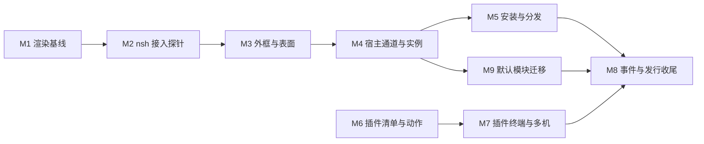

# 扩展机制开发计划 v0.1

[返回 README](../README.md) · [界面模块](mods.md) · [插件](plugins.md)

版本：v0.2（2026-11-06）
状态：实施中。M1–M4 已交付（提交 `6917533`、`faf940f`、`e97a9df` 与本次提交），M5 及之后未开始；逐项见 [§3.1 里程碑交付状态](#31-里程碑交付状态)。
对应规格：[界面模块 v0.3](mods.md)、[插件 v0.1](plugins.md)。

本计划按依赖顺序拆成两个可并行的轨道，汇合到发行收尾。每个里程碑都能独立评审、独立回退，结束时全套测试保持通过。

## 1. 交付边界

| 轨道 | 里程碑 | 交付 |
|---|---|---|
| 渲染与界面 | M1–M5 | ratatui 0.30 基线；nsh 嵌入；外框与表面；宿主通道；模块安装与分发 |
| 默认模块 | M9 | 8 个默认模块接管 60% 界面逻辑，内置实现保留为回退 |
| 工作流 | M6–M7 | 插件清单与动作；终端入口与多机 |
| 汇合 | M8 | 事件流、共享契约回归、四平台发行、文档定稿 |

两轨并行时共享 `Cargo.toml`、`src/config.rs`、`README.md` 三个冲突点；每个里程碑按文件拆分提交，先合入的轨道为另一方保留占位。

## 2. 依赖顺序

M6 只依赖现有动作分发器与控制 socket，可与 M1–M5 同时进行。M9 在 M4 完成后即可开始，与 M5、M6、M7 并行。

## 3. 默认模块拆分

默认界面拆成 8 个模块与 1 个共享组件库。模块随二进制分发，默认外框绑定它们；内置实现保留为 `--no-mods` 与单个模块禁用时的回退。

| # | 模块 | 接管的现有界面 | 常驻 | 主要数据 | 主要动作 |
|---|---|---|---|---|---|
| 1 | `sidebar` | 侧栏 Spaces 与 Agents、紧凑轨道、折叠组、滚动 | 是 | spaces、agents、tabs 计数、分支、未读与状态、折叠状态 | `space.select`、`agent.focus`、`space.new`、`space.rename`、本地折叠 |
| 2 | `tabs` | Tab 栏，上/下两种位置 | 是 | tabs、settled、状态、当前 Tab | `tab.select`、`tab.new`、`tab.close`、`tab.rename`、`tab.move` |
| 3 | `status` | 模式行、连接状态、Agent 计数、快捷键提示 | 是 | 连接、模式、按键提示、计数、当前 Space 与 Tab | 无，纯展示 |
| 4 | `picker` | 命令面板与 Go to | 按需 | 命令目录、spaces、tabs、panes、terminals、agents | `run`、`space.select`、`pane.focus`、`agent.focus` |
| 5 | `dialogs` | 文本输入、确认、单选菜单、Pane 与 Space 右键菜单、机器选择 | 按需 | 标题、默认值、选项、目标上下文 | 返回结果给宿主；`run` 菜单项 |
| 6 | `settings` | 设置浮层 | 按需 | 设置 schema、当前值、可选主题 | 写配置 |
| 7 | `help` | 键位浮层 | 按需 | 键位表、过滤查询 | 无 |
| 8 | `toast` | 提示条、错误、Agent 完成提醒 | 是 | 通知队列、级别、动作 | 点击执行通知动作 |

`ui-base` 是共享 TSX 组件库，不是运行时模块：主题 token、列表与表格、徽章、按键提示、空状态、滚动容器。

不计入默认模块的区域：终端内容、光标、复制模式、历史搜索、Kitty 图片与遮挡、Pane 边框与标题、浮动拖动、分隔线、Pi Chat、手机单列布局、Peek/Reader。后续可选模块为 `chat`、`pane-header`、`peek`；第三方模块不计入默认清单。

合并理由：`sidebar` 的 Spaces 与 Agents 共用列宽、滚动与折叠语义；`picker` 的两处界面共用搜索、键盘导航与结果渲染；`dialogs` 的输入、确认与菜单共用返回通道；`toast` 需要非聚焦常驻，不能占用停靠区。

60% 的度量口径：统计 `src/ui/` 与 `src/app/interaction.rs` 中八个区域相关的绘制、命中区域、菜单构建、提示与浮层状态代码，排除终端、Chat、图形、复制模式、Pane 装饰。默认模块接入默认外框后，被删除或替换的 Rust 界面代码达到该口径的 60% 即达标；迁移前后行数与模块清单写入本文验收节。

## 3.1 里程碑交付状态

| 里程碑 | 状态 | 交付记录 |
|---|---|---|
| M1 渲染基线 | ✅ 已交付（`6917533`） | ratatui 0.30.2 + crossterm 0.29；导入全部迁到 ratatui-core / ratatui-widgets / ratatui-crossterm，facade 零残留；80×24 / 120×40 帧快照升级前后逐格 0 差异；单元、回放、遮挡、E2E、smoke 全过 |
| M2 nsh 探针 | ✅ 已交付（`faf940f`） | 固定 nsh `951556dc`；`nsh-platform-tui` + `nsh-engine`（default-features off、js on）；`tests/mods_probe.rs` 在 TestBackend 的 Pane 矩形内加载最小 TSX bundle，验证按键/鼠标/粘贴/resize/唤醒/退出/干净停止；musl 双目标冷构建基线与第三方声明写入 docs/release.md |
| M3 外框与表面 | ✅ 已交付（`e97a9df`） | `src/mods/chrome.rs` 外框树（row/column/block、serde 往返、未知字段拒绝、折叠规则）；`ui::draw` 改外框驱动，默认帧与 M1 逐格一致；state.json schema 4（`mods_chrome`、`mods_windows`）；`mods.dock` / `mods.undock` / `mods.chrome` 动作；`--no-mods`；Kitty 图片按模块区域遮挡、关闭恢复；`pane.go` 焦点循环泛化为组合目标，无表面的模块区域不参与 |
| M4 宿主通道与实例 | ✅ 已交付（本次提交） | `src/mods/mod.rs` 表面注册表（代际/授予/请求/位置记忆，`grants_for`、pending 与 `WindowPos` state 形态）；`src/mods/host.rs`（params、15 个方法、`exec` 子进程 30 s/8 MiB/单表面并发 4、远端路由）；`src/mods/input.rs`（crossterm→Input，含测试）；`src/mods/render.rs`（region/pane/dialog/popup/window 的 z 序、8 ms/32 ms 预算、失败表面错误行）；`src/mods/check.rs`（清单校验、`host_api`/`min_hc_tui_version`、80×24 试渲染、`nsh check` 包装）；`src/app/mods.rs`（调用分发、快照与领域过滤、事件、staging 重载、授予确认、键鼠粘贴路由、覆盖层 Esc、停靠表面同步、窗口位置记忆）；App 接线（`mods`/`mod_revision`/`mod_wake`/`mods_dirty`/`pending_mod_rpc`/`mod_agent_order`/`mod_chrome_sync`）、`ui::draw` 表面绘制、`pane.go` 焦点循环、`mods.*` 动作、`app.ready`/`state.changed`/`terminal.*`/`focus.changed`/`theme.changed`/`grant.changed` 触发点、`state.json` 的 `mods_grants`；三个示例 `examples/mods/{agents,spaces,prs}` 通过 `hc-tui mods check` |
| M5 安装与分发 | ⏳ 未开始 | |
| M6 插件清单与动作 | ⏳ 未开始 | 可与 M4–M5 并行，只依赖现有动作分发器 |
| M7 插件终端与多机 | ⏳ 未开始 | |
| M8 事件与发行收尾 | ⏳ 未开始 | |
| M9 默认模块迁移 | ⏳ 未开始 | |

验证基线（M2 起，docs/release.md 同步记录）：musl amd64 冷构建约 106 s / 5.78 MiB，arm64 约 182 s / 5.22 MiB；nsh 未接线阶段发行体积增量 +136 KiB。

## 4. 里程碑

### M1 渲染基线

目标：升级到与 nsh TUI 相同的 ratatui 代际，之后所有界面工作建立在这一基线上。

工作项：

- `Cargo.toml`：`ratatui = "0.30.2"`、`crossterm = "0.29"`。
- 导入路径迁移：`ratatui-widgets`、`ratatui-core` 的 `Frame`、`Buffer`、`Backend`、`style`、`text`。
- `src/tui.rs`：raw mode、alternate screen、鼠标捕获与恢复。
- `src/term/input.rs`、`src/app.rs`、`src/app/interaction.rs`：按键与鼠标事件结构变化。
- 测试语料与帧快照更新；`scripts/capture-nvim.py` 等采集脚本核对。

退出条件：

- `cargo fmt --check`、`clippy -D warnings`、`cargo test` 通过。
- `HC_TUI_E2E=1` 的 `g1_attach`、`multi_pane` 通过；`just smoke` 通过。
- 默认界面在 80×24 与 120×40 下的帧快照与升级前一致。
- 图片遮挡与真实字节回放测试通过。

不包含：nsh 依赖、任何界面行为变化。

### M2 nsh 接入探针

目标：证明 `AppView` 能在 hc-tui 的帧里绘制、收输入、被唤醒并干净退出，并锁定依赖与构建路线。

工作项：

- 固定 nsh 提交；以 git 依赖引入 `nsh-platform-tui`（`default-features = false`，启用 `js`）与 `nsh-engine`。
- 构建探针：Linux musl amd64/arm64、macOS x86_64/aarch64 各构建一次，记录二进制体积与编译时间。
- 临时二进制或集成测试：在 `TestBackend` 与一个 Pane 矩形里加载最小 bundle，投递按键、鼠标、粘贴、resize，验证唤醒与停止。
- `THIRD-PARTY-NOTICES.md` 增加 nsh、QuickJS 与传递依赖。

退出条件：

- 最小 TSX 模块在矩形内显示并按 `render(frame, rect)` 绘制，按键与鼠标到达模块。
- 模块停止后不残留线程，退出码正确。
- 四个目标全部构建通过，体积与编译时间记录在 `docs/release.md` 的基线表。
- 未启用模块时界面行为与 M1 一致。

不包含：外框、宿主通道、安装与分发。

### M3 外框与表面

目标：把内置界面改成外框树驱动，并为模块区域、Pane 内视图、覆盖层预留完整路径。

工作项：

- `src/mods/chrome.rs`：区域树解析、序列化、默认树、尺寸与折叠计算。
- `src/ui/mod.rs`：按区域绘制内置内容；模块区域调用 `render`；覆盖层按 z 序绘制；光标定位。
- `src/app/interaction.rs`、`src/app.rs`：输入仲裁、焦点循环、`pane.go` 纳入 `focusable` 区域、前缀与双前缀、模态只投顶层。
- `src/term/graphics.rs`：模块区域与覆盖层的遮挡矩形、图片重传。
- `src/config.rs`：`state.json` schema 4 的 `mods_chrome`、`mods_windows`。
- `src/main.rs`：`--no-mods`。
- `mods.dock`、`mods.undock`、`mods.chrome` 动作。
- 默认外框的 `mod` 绑定来自内置模块清单；内置绘制保留为回退。

退出条件：

- 默认外框渲染结果与 M1 的帧快照一致。
- 把侧栏换到右侧、把 Tab 栏换到下方后，行为与默认一致。
- 覆盖层打开时，其下的 Kitty 图片被遮挡，关闭后恢复。
- 前缀、双前缀、模块内 Tab 导航、`Esc` 关闭浮层的用例通过。
- `--no-mods` 使用内置外框且不加载 nsh。

不包含：宿主方法、数据快照、热重载。

### M4 宿主通道与实例

目标：模块能读工作台状态、执行动作、访问文件与远端、发通知，并在失败与重载下保持界面可用。

工作项：

- `src/mods/host.rs`：`params`、`state` 与 `revision`、事件投递、方法分发与授予校验、`run`/`request`、`action.finished`、错误码。
- 视图模型快照：侧栏行、Tab 行、状态字段、命令目录、键位表、设置 schema、提示与选项，宿主推导未读、分组与优先级。
- 浮层请求与结果：`overlay` 携带 props，`overlay.result` 返回选择或输入，取消返回 `cancelled`。
- 提示队列：`toast` 的级别、超时与动作由宿主统一投递。
- `src/mods/mod.rs`：实例注册、generation、staging 重载、日志、崩溃重启、`mods.disable/enable`。
- `src/mods/render.rs`、`src/mods/input.rs`：表面矩形、命中、坐标换算、光标。
- `src/app/actions.rs`、`src/app/interaction.rs`：`mods.*` 动作、菜单项、命令目录。
- `examples/mods/agents`、`spaces`、`prs`；`mods check` 的无窗口试渲染。
- 主题 token 与 `TerminalCapabilities` 对接。

退出条件：

- 三个示例通过 `hc-tui mods check` 与 `nsh test`；列表数据与内置侧栏逐项相等。
- 拒绝 `exec` 后调用返回 `forbidden` 且无副作用；`requestGrants` 能追加授予。
- `revision` 跳号后重新取快照；断线后 `app.ready` 触发重取。
- staging 失败保留旧实例与旧帧；旧 generation 的迟到回复被丢弃。
- 故意崩溃、超内存、超调用时间只有该实例受影响。
- 模块区域与覆盖层不写共享文档，未知字段与 props 往返保留。

不包含：安装代际、签名包、trust roots。

### M5 安装与分发

目标：模块可以安装、更新、回滚、签名校验与撤销，命令行不依赖运行中的窗口。

工作项：

- 通用代际存储模块 `src/store.rs`：`store/<id>/<generation>`、`current` 指针、records、引用计数与回收。
- `src/mods/store.rs`：模块来源（linked/local/packaged）、安装预览、更新与卸载。
- 签名包：`nsh publish` 产物校验、trust roots、撤销列表、`min_runtime`。
- `src/control.rs`：`mods.open/close/reload/grant/dock`。
- `src/main.rs`：`mods list/check/test/build/install/update/uninstall/link/unlink/log/grant/enable/disable`。
- `src/config.rs`：`[mods] trust_roots` 与路径解析。

退出条件：

- 安装、更新、回滚、卸载各自有用例；运行中的实例继续使用旧代际，关闭后回收。
- 签名包在信任根下通过校验，撤销列表生效，`min_runtime` 不满足时拒绝并说明。
- 所有只读命令在无窗口时可用；`mods list --json` 字段稳定。
- 本地链接与安装目录两种来源都能热重载，失败保留旧版本。

不包含：插件。

### M6 插件清单与动作

目标：插件能声明动作、进入命令目录与菜单，并以受限进程方式运行，结果可查询、可取消。

工作项：

- 新增 `toml` 依赖；`src/plugin/manifest.rs` 严格解析、未知键拒绝、参数 JSON Schema 子集校验、命令描述与上下文。
- `src/plugin/registry.rs`：来源、清单哈希、启用状态、预览；复用 `src/store.rs` 的代际与引用回收。
- `src/plugin/runner.rs`：stdin 上下文、注入变量、超时、取消、进程组回收、有界输出、全局与单包并发、队列。
- `src/plugin/logs.rs`：轮转、查询、失败摘要。
- `src/app/plugin.rs`：上下文构造、目标冻结、菜单与命令目录接入、结果展示。
- `src/main.rs`、`src/control.rs`：`plugins action list/invoke/status/cancel/log`。
- `[[keys.command]] type = "action"` 与命令面板接入同一分发器。

退出条件：

- `git-tools` 动作在本机与远端 workspace 上运行，切换焦点不改变目标。
- 超时、取消、输出洪泛、持续持有管道后代的用例都能在期限内结束并回收。
- 并发与队列上限生效，界面输入不被阻塞。
- 禁用后动作从目录与菜单消失；内置动作不可覆盖。
- `[[panels]]`、`[[keys.command]]`、`mod.open` 行为不变。

不包含：终端入口、事件流。

### M7 插件终端与多机

目标：插件能在正确的机器上打开真实终端，路径与依赖检查明确，错误不静默回退本机。

工作项：

- `[[terminals]]` 入口：`terminal.run` 参数、环境注入、placement 映射、标签、Pane 定位。
- 包内相对程序的解析规则与同机限制；`requires_programs` 的目标机器检查。
- `plugins pane open/focus/close` 与标签定位。
- 离线、缺失程序、目标删除、机器不匹配的错误与提示。
- `git-tools` 与 `review` 两个示例插件。

退出条件：

- 远端 Space 打开 lazygit，cwd 与环境变量正确。
- detach 后终端继续运行；关闭 Pane 不结束程序；卸载保留代际直到终端结束。
- 包内相对程序在远端请求时返回 `unsupported` 并说明，不回落本机。
- 缺失程序、离线、`target_gone` 各有用例。

不包含：事件流、发行。

### M8 事件与发行收尾

目标：事件流可用、共享契约无回归、四平台发行与文档定稿。

工作项：

- `src/control.rs`：`events` 长连接、按 `--plugin` 与 `--kinds` 过滤、有界队列与 `events.dropped`。
- `src/main.rs`：`hc-tui events`；插件事件消费示例。
- 共享契约回归：module 节点、未知字段、props、CAS 合并与冲突提示。
- 四平台发行构建与安装脚本验证；`docs/release.md` 更新。
- 两份规格与 README、配置、命令、开发文档同步；删除临时探针与调试开关。

退出条件：

- 两份规格的验收清单全部通过。
- `just smoke`、`just parity` 与 4 目标构建通过。
- 输入延迟、空闲 CPU、常驻内存、二进制体积与 M1 基线对比记录，无不可解释的回归。
- 事件流断开即停、溢出发出 `events.dropped`、两个客户端各收到一次。
- `--no-mods`、禁用全部模块、禁用全部插件三种状态下界面与终端功能完整。

### M9 默认模块迁移

目标：8 个默认模块接管对应界面，默认外框绑定模块，被替换的 Rust 界面代码达到 60% 口径，内置实现保留为回退。

工作项：

- `ui/` 下的 `ui-base` 与 8 个模块；构建为 bundle 并嵌入二进制，随 hc-tui 版本更新。
- 宿主视图模型、`overlay.result`、提示队列在模块内使用；标签、图标、徽章与主题来自 `ui-base`。
- 默认外框绑定 `sidebar`、`tabs`、`status`、`toast`；`picker`、`dialogs`、`settings`、`help` 按需打开。
- `mods clone <id> [--as 名称]`：把内置模块复制到配置目录供用户修改。
- 删除被替换的 Rust 绘制、命中区域与菜单构建；保留回退路径与 `--no-mods`。
- `scripts/mods-coverage.py`：统计迁移前后 `src/ui/` 与 `src/app/interaction.rs` 的目标区域行数，输出比例与清单。
- 中英文文案随模块分发，语言由 `host.params.locale` 决定。

退出条件：

- 8 个模块通过 `hc-tui mods check` 与 `nsh test`；默认外框确实加载它们。
- 80×24 与 120×40 帧快照与内置实现一致；有意差异在验收记录中逐项列出。
- `scripts/mods-coverage.py` 报告被替换比例不低于 60%，清单固化到本文验收节。
- 点击、右键、滚轮、拖拽、键盘导航、输入法组合、前缀与双前缀在模块区域与内置区域表现一致。
- `--no-mods` 与单个模块禁用后回退到内置实现，功能完整。
- 外框与模块状态不写共享文档；未知字段与 props 往返保留。
- 输入延迟、空闲 CPU、常驻内存与 M1 基线对比记录，均无不可解释的回归。

不包含：`chat`、`pane-header`、`peek`；第三方模块。

## 5. 跨里程碑工作

| 项 | 内容 | 涉及里程碑 |
|---|---|---|
| 配置 | `state.json` schema 4、`[mods] trust_roots`、路径解析、迁移读取 | M3、M5 |
| 默认模块 | `ui-base`、8 个模块、默认外框绑定、60% 行数统计脚本 | M4、M9 |
| i18n | 新增提示、错误码、授予说明、CLI 输出 | M3–M9 |
| 文档 | README、configuration、commands、development、herdr-app-alignment、release、THIRD-PARTY-NOTICES | 每个里程碑 |
| CI | `just mods-check`、`just plugins-check`、`mods-coverage`、4 目标构建缓存、帧快照对比 | M1、M2、M5、M8、M9 |
| 性能 | 帧快照、输入延迟、空闲 CPU、内存、体积基线记录 | M1、M2、M8、M9 |
| 日志 | 统一错误码与日志字段，模块与插件共用查询入口 | M4、M6 |

## 6. 验证与预算

| 项 | 方法 | 门限 |
|---|---|---|
| 默认界面 | 80×24、120×40 帧快照 | 与升级前逐格一致 |
| 输入 | nvim、英文快速输入、bracketed paste、前缀与双前缀、焦点进出 | 与基线对比无可见退化 |
| 模块渲染 | 单表面 8 ms、整帧 32 ms；`frame_metrics` 记录 | 超出保留上一帧并记账 |
| 空闲 CPU | 无动画、无事件时空转 | 与原生基线对比记录 |
| 内存 | 单实例、多实例、断线重连 | 受 `Limits` 约束，无持续增长 |
| 图片 | Kitty 图片 + 模块区域 + 覆盖层 | 覆盖层遮挡，关闭后恢复 |
| 默认模块 | 8 个模块替换内置区域，`--no-mods` 对照 | 帧快照一致；被替换代码达到 60% 口径 |
| 共享契约 | module 节点、未知字段、props、CAS | 往返不变，冲突不覆盖 |
| 插件 | 超时、取消、输出洪泛、持有管道后代、并发 | 期限内结束，进程组回收，界面可输入 |
| 多机 | 远端动作、远端终端、离线、缺失程序、目标删除 | 正确机器执行或明确错误 |
| 发行 | 四目标构建、安装脚本、撤销与 `min_runtime` | 全部通过 |

## 7. 风险与处理

| 风险 | 处理 |
|---|---|
| nsh TUI 处于快速变化期，接口可能变动 | 固定提交并按月评估升级；升级单独分支，附帧快照、图片遮挡、示例模块回归 |
| ratatui 0.30 迁移引入渲染回归 | M1 单独提交，帧快照、真实字节回放与图片测试作为门禁 |
| 依赖体积与编译时间上升 | M2 记录基线；关闭未用 feature；对比四个目标；必要时裁剪 `nsh-base` 的可选组件 |
| 输入路径变慢或按键被吞 | 焦点切换与高负载基准；宿主前缀优先；模块未处理键不回落 PTY |
| 模块热重载产生重复副作用 | staging 实例 + generation；激活前宿主方法返回 `staging`；旧回复按代际丢弃 |
| 图片遮挡遗漏 | 遮挡矩形纳入 `graphics.draw`；覆盖层开关与分屏用例覆盖 |
| 插件进程与管道泄漏 | 进程组终止、2 秒后 SIGKILL、持续读取输出、引用回收；用例覆盖持有管道的后代 |
| 远端路径误用 | 包内相对程序同机限制、`requires_programs` 目标机器检查、错误码区分 `unsupported` 与 `target_gone` |
| 共享文档被界面写入 | 外框与模块状态只存本地；契约测试覆盖未知字段与 CAS |

## 8. 发布与回退

- 发行默认启用模块运行时与插件注册表；内置界面不依赖模块，`--no-mods` 与 `plugins disable` 可回到纯内置界面。
- 每个里程碑独立提交；回退一个里程碑不牵连其它轨道。ratatui 升级（M1）与 nsh 引入（M2）保持独立提交。
- 插件与模块的信任根、撤销列表随发行包文档提供；撤销后已安装的签名包拒绝加载。
- `state.json` schema 4 只新增字段；回退到旧版本时旧版本按缺失字段为空处理。

## 9. 文档同步清单

| 文件 | 内容 |
|---|---|
| `README.md` | 文档导航、功能与边界表、安装说明 |
| `docs/mods.md` | 外框、表面、宿主方法、授予、安装、验收 |
| `docs/plugins.md` | 清单、动作、终端、多机、安装、验收 |
| `docs/configuration.md` | 模块与插件目录、`[mods]`、`state.json` schema 4 |
| `docs/commands.md` | `mods.*`、`plugins.*`、`hc-tui events` |
| `docs/development.md` | `src/mods/`、`src/plugin/`、`src/store.rs`、验证命令 |
| `docs/herdr-app-alignment.md` | module 映射、未知模块占位、共享边界 |
| `docs/release.md` | 四目标构建、体积与内存基线、第三方声明 |
| `docs/mods.md`、`docs/plan-extensions.md` | 默认模块清单、60% 度量、内置回退 |
| `THIRD-PARTY-NOTICES.md` | nsh、QuickJS、TOML 解析与传递依赖 |
