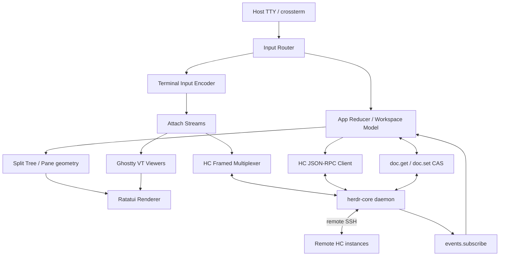

# HC TUI：基于 Herdr Core 的原生终端工作台完整设计

> 历史资料：保留当时的设计与评审，不代表当前功能。当前入口见 [README](../README.md)、[使用指南](usage.md) 和 [对齐契约](herdr-app-alignment.md)。

版本：v1.0（2026-11-04）  
定位：Rust 原生 TUI、Agent-first、多终端、多机器、可恢复的 Herdr Core 客户端。  
资料基线：herdr-core v0.1.17 与 herdr TUI v0.9.5；正式开发前锁定 commit 并对本机 `hc schema` 进行校验。

## 0. 执行摘要

推荐 **独立 Rust 客户端 + Herdr Core RPC + Ratatui + 原 Herdr TUI 的 Ghostty VT 封装**。hc 负责 PTY/进程/Holder/持久化/SSH/状态报告；客户端负责 Workspace、Tab、Pane、VT Viewer、键鼠、滚动、通知和 UI 状态。源码可参考原版，但不要将其旧 Server 一并移植。

最先验证 framed attach 的端到端闭环：`hello` → `terminal.run` → `terminal.attach` → DATA → VT parser → Ratatui Buffer → 键盘 DATA → RESIZE → CREDIT → CLOSE。完成后再叠加布局和 Agent 功能。

## 1. 范围和产品原则

### 1.1 首版必须有

1. Workspace、Tab、横/纵分屏、Pane 焦点、缩放、切换、拖动大小。
2. Sidebar：工作区/机器树与 Agent 列表，支持鼠标点击和键盘导航。
3. Shell、Pi、Codex、Claude 等任意 CLI 作为普通终端启动；Agent 通过 OSC 7501 上报状态时显示 Working/Blocked/Done/Idle/Error。
4. 实时终端输入、全色彩 ANSI、alternate screen、Unicode、滚动与复制、粘贴。
5. Core 保活，detach 后进程继续运行；客户端重启恢复 UI 布局及仍存在的终端。
6. 远程 hc 终端的发现、attach、输入与状态列表；SSH 由 Core 负责。
7. 可配置快捷键、主题、状态栏、日志与错误界面。

### 1.2 首版暂缓

- 原生语义 Chat UI（需要各 Agent 自己的结构化事件源）；可保留接口，作为 V2。
- 文件树、Diff、Browser、图像 Canvas、终端 Kitty Graphics 精确呈现，作为增强功能。
- 完全复现原 Herdr 的设置页、Worktree、全部插件和 popup 类型。
- Web/Android/Windows 首发版本。

### 1.3 核心产品原则

- Core 拥有 Terminal；TUI 拥有 View/Pane/Layout。终端生命期与 Pane 生命期分离。
- 关闭 TUI / Detach 只断开视图；显式 Kill 才结束程序。关闭 Pane 默认仅移除布局引用，最后一个引用也可保留后台终端。
- 单向状态流：终端元数据使用 Core 的 `terminal.list` 初始快照和 `events.subscribe` 增量事件。界面不得猜测终端任务是否完成。
- 屏幕数据独立于 Agent 状态数据：终端 ANSI 只给 VT 模拟器，`status` 事件只给状态层。
- 一台机器不可达时，其他机器与本地工作区继续使用；重连后自动全量对齐。

## 2. 上游技术基线

资料：
- https://github.com/herdrdev/herdr-core
- https://github.com/herdrdev/herdr-core/blob/master/schema/README.md
- https://github.com/herdrdev/herdr-core/blob/master/schema/hc.openrpc.json
- https://github.com/herdrdev/herdr/tree/master/crates/ghostty-vt
- https://github.com/herdrdev/herdr/blob/master/src/ui/panes.rs
- https://github.com/herdrdev/herdr/blob/master/src/layout.rs
- https://github.com/herdrdev/herdr/blob/master/src/ui/sidebar.rs
- https://github.com/herdrdev/herdr-app

Core 0.x 协议 generation 1，稳定性由官方 `released.openrpc.json` 的兼容性测试约束；客户端运行时通过 `hello` 获取方法和 features，避免依赖猜测。hc 的 Linux 发行版以静态形式提供；新的 TUI 发行方式需要独立验证。

关键 API：`hello`, `terminal.run`, `terminal.list/get/read/attach/send/keys/keep/kill/rm/label`, `events.subscribe`, `doc.get/set`, `machine.list/add/rename/connect`, `server.status`。全量定义以运行时 `rpc.discover`/`hc schema` 为准。

Core 自带的 `ghostty-vt` 封装暴露 `paint`、`screen_rows` 等服务端能力；旧 TUI 的 Ghostty 封装已有 `RenderState`, `RowIterator`, `RowCellIter`, `CellStyle`, `KeyEncoder`, `MouseEncoder`、滚动、Hyperlink、Kitty 等更完整的客户端渲染能力。优先从旧 TUI 选择性移植 `crates/ghostty-vt`（Apache-2.0，保留原许可证和第三方 notices）。该包 build.rs 使用 Zig 0.16，引用 vendored libghostty-vt；必须在 CI 验证 Zig 版本、submodule 和静态链接。

## 3. 总体架构



**进程边界**：`hc-tui` 一个前台终端程序；`hc` 为用户后台守护进程；Core 的 Holder 拥有子进程；不由 hc-tui 创建额外 PTY。`hc-tui` 首期通过启动 `hc connect` 子进程进行双向通信，以获得现成的 endpoint 路径解析、自动启停与跨平台桥接；后期优化 Unix Socket 直连，须复现 Core 的 endpoint/session 规则。

## 4. 源码目录（目标结构）

```text
hc-tui/
├── Cargo.toml
├── Cargo.lock
├── README.md
├── LICENSE
├── THIRD-PARTY-NOTICES
├── docs/
│   ├── product.md
│   ├── architecture.md
│   ├── protocol.md
│   ├── ux.md
│   ├── testing.md
│   └── adr/
├── crates/
│   ├── app/                 # App state, actions, reducer
│   ├── hc-proto/            # OpenRPC typed models, framed codec
│   ├── hc-client/           # connect, JSON-RPC, attach, events, docs
│   ├── term-view/           # Ghostty VT instance, cell mapping, key/mouse, scroll
│   ├── workspace/           # split tree, data model, persistence and reconciliation
│   ├── agent-state/         # OSC 7501 status, attention queue, turn-seen
│   ├── ui/                  # Ratatui layout + widgets + panels
│   └── ghostty-vt/         # vendored wrapper from original Herdr TUI
├── src/main.rs             # binary startup + terminal guard
├── tests/
│   ├── fixtures/           # captured ANSI and framed traces (sanitized)
│   ├── protocol/
│   └── integration/
└── .github/workflows/
```

最初可以用单 Cargo package + `src/{app,core,terminal,layout,ui,...}` 实现，待模块稳定再拆分 workspace crates，以免过早引入模块发布负担。`hc-proto` 与渲染绝不互相依赖。

## 5. 客户端运行时及协议

### 5.1 连接启动

1. 读取 `config.toml`，获取 HC_SESSION、可选 HC_SOCKET、运行方式。
2. 运行 `hc connect`（或将来使用 Unix Socket），建立双向字节流。
3. Plain JSON-RPC 发送 `hello {"framed":true,"features":["automatic_input","resize_notifications"]}`；读取 Plain JSON-RPC 回复后切换 Framed 解析。以 `hello` 返回为能力协商依据。
4. 检查 `generation`，只支持已实现 generation；`methods` 中缺少必须的 API 时报告版本不匹配。
5. Frame channel 0 承载所有 JSON-RPC 响应/请求；每个 attach 独立 stream channel；事件订阅也有 channel。
6. 优先订阅 `events.subscribe`，拿到 `seq` 与 terminal snapshot；再读取 workspace docs 和机器清单，避免遗漏并发变化。

### 5.2 Framed 编码

Header = `[channel: u32 LE][kind: u8][length: u32 LE]`，9B；payload 最大 16 MiB。

- DATA=0：channel0 为 JSON-RPC；其他 channel 为 VT 字节或输入。
- CREDIT=1：u32 LE，已消费的 DATA 字节数；每流初始额度 256 KiB。
- CLOSE=2：关闭 attach channel；程序结束时 payload 携带 reason。
- RESIZE=3：列/行，各 u16 LE；同一个 Viewer 只按真实内容区尺寸发送。
- FOCUS=4：焦点 1/0。
- FACTS=5：颜色、cell px 等 viewer 属性。
- AUTOMATIC_INPUT=6：终端自动答复，仅协商支持后发送。

必须实现：严格校验 `len <= 16 MiB`，未知 kind 的处理规则，单 writer 串行化 Frame，channel 生命周期映射；JSON-RPC 按 `id` 关联并发请求；解析半包、粘包；大小端测试；不可让某个 Pane 的流量阻塞控制 channel。

### 5.3 订阅事件

事件通道携带 `event`、`heartbeat` 和 `missed`。`events.subscribe` 的返回值含当前 snapshot 和 `seq`。Reducer 按事件序号顺序应用：

- `created/restarted`: 添加或替换整个 terminal record。
- `finished/removed/lost`: 更新退出/暂失状态，结束/恢复 attach。
- `status/turn`: 更新 Agent 状态、完成轮数和 attention queue。
- `title/labels/size/foreground`: 更新 UI 相关字段。
- `doc`: 根据 doc name 拉取新文档；该事件只发给无过滤订阅者。
- `missed`: 丢弃可能不连续的本地事件缓存，用最新 snapshot 重建终端集合，重新加载 Docs。
- socket EOF / heartbeat 超时 / Core 重启：重新 `hello → subscribe → list/docs → reattach`；重新订阅后 `seq` 重新建立基线，不跨进程比较。

### 5.4 Attach 生命周期

Pane 被显示时：

1. 获取终端实际内容区 `(cols, rows)`。
2. 调用 `terminal.attach {terminal,cols,rows,history:0,observe:false,resize_notifications:...}`。
3. `AttachResult.channel` 建立 `TerminalView`；向 VT 模拟器输入首帧的 authoritative paint，然后后续 DATA。
4. VT 模拟器更新屏幕、dirty rows 与 cursor，通知 UI render scheduler。
5. 待输入字节被 VT parser 消费后按 consumed 字节发送 CREDIT；队列必须有上限。渲染聚合为 30~60 FPS，终端字节解析不与 UI 刷新率绑定。
6. 焦点变化/内容区变化以 FOCUS/RESIZE 更新 Core。输入只给当前可写 viewer；同一 terminal 的第二个镜像 pane 使用 observe=true。
7. 隐藏 tab 可以 CLOSE attach 以节省资源；重新显示 attach 时 Core 重新发画面；全局状态订阅不断开。
8. 退出 TUI 发送 CLOSE 并终止本地 client 连接，仍然保留 Core Terminal。

对于 observe：只有当 `resize_notifications` 的协商结果为真时，才依赖来自 Core 的 RESIZE 和随后的 authoritative repaint，且先更新 VT 宽高再解析后续 DATA；旧 Core 退化为单 active viewer 或定期尺寸事件对齐。

失去连接的 attach 不等于终端结束：在 UI 上标为 reconnecting，重建 Core 连接后重新 attach。`keep` 触发的 `restarted` 表示已切换到新 shell，不表示原 agent 任务自动恢复。

## 6. 终端渲染与输入

### 6.1 VT 端

每个活跃 TerminalView 持有 `ghostty_vt::Terminal` + `RenderState` + scroll offset + image/hyperlink state。输入 DATA 时调用 `Terminal::write`；行迭代器获得 grapheme、宽字符、前后景颜色、粗体、下划线、反色等属性；写到 Ratatui Buffer 的对应 Rect（绝不覆盖外层 pane border、Sidebar）。

必须正确处理：
- ANSI 16/256/truecolor，Unicode/宽字符/组合字符。
- Main / alternate screen 切换；全屏 Vim、Neovim、Pi、Codex、fzf 等。
- 光标位置和样式，终端尺寸变化及软换行。
- 局部 dirty rows、scrollback、copy mode、选择高亮与搜索。
- `OSC 52` 剪贴板，Hyperlink，Title：边界要经过安全过滤。
- 用户真实输入经 Ghostty KeyEncoder / MouseEncoder 编码成 VT 字节；bracketed paste 使用当前子终端模式，并避免文本按字符发送带来的性能问题。
- 查询回复由 VT Viewer 生成时，使用 AUTOMATIC_INPUT，需两个端点均已协商支持；避免把自动查询答复当作人工交互。

初期可以用 `vt100` 实现无图像的最小端到端验证，但正式版选择 Ghostty VT（原版封装有样式 Cell API）。Ghostty vendored 的 Zig 构建需单独先打通，包含许可声明和可复现版本固定。

### 6.2 Host TTY 与焦点

外层 crossterm 提供 Raw Mode、Alternate Screen、鼠标、Paste、Resize、终端主题/颜色探测。入口创建 RAII `TerminalGuard`，正常退出、panic、SIGTERM 均尽力恢复外层终端状态。

输入路由：

```text
HostKey / HostMouse
  -> Global Modal?        yes: handle dialog
  -> Prefix Mode?         yes: map to AppAction
  -> Navigation Mode?     yes: focus/select
  -> Mouse on chrome?     yes: UI action
  -> Copy Mode?           yes: selection/scroll
  -> Focused TerminalView -> KeyEncoder/MouseEncoder -> Attach DATA
```

不要通过 `terminal.send` 实现逐键输入：send 会做粘贴并提交 Enter；逐键交互应使用 attach stream 的 DATA。`terminal.send` 仅用于“向 Agent 发送一条文本消息”式操作。

### 6.3 性能

- 每个 VT 单线程串行状态机；网络/pipe 读写可在独立 Tokio task。
- 只更新 changed rows/cells；输入与 RPC 更新采用消息队列，不在 UI render 中 `await`。
- 30 FPS 默认，键入焦点 Pane 优先；大输出场景可自适应到 60 FPS。
- 保留少量 terminal data backlog，确保 CREDIT 与内存 backpressure；超过阈值优先依靠 Core 的重绘机制。
- 只 attach 可见 Pane，隐藏 tab 依靠 Core 历史及重新画面恢复。

## 7. Workspace / Tab / Pane 数据模型

```rust
struct AppModel {
    machines: HashMap<MachineId, MachineView>,
    terminals: HashMap<TerminalAddress, TerminalRecord>,
    workspaces: Vec<Workspace>,
    current_workspace: WorkspaceId,
    ui: LocalUiState,
}
struct Workspace {
    id: WorkspaceId,
    name: String,
    machine: MachineId,
    root_cwd: String,
    tabs: Vec<Tab>,
    active_tab: TabId, // 保存为客户端本地偏好
}
struct Tab { id: TabId, name: String, root: SplitNode }
enum SplitNode {
    Leaf { pane_id: PaneId },
    Split { axis: Axis, ratio: f32,
            first: Box<SplitNode>, second: Box<SplitNode> },
}
struct Pane {
    id: PaneId,
    terminal: TerminalAddress,
    title_override: Option<String>,
}
```

设计规范：
- `PaneId` 与 `TerminalAddress` 独立，允许一个 Core Terminal 出现在不同布局视图；附加 viewer 必须协调 observe。
- Workspace 默认绑定一台机器与一个根目录；可以从全局 Agents 列表进入另一个机器的终端。
- Split Tree 使用 BSP，比例限制在合法区间；最小内容区建议 20x5，空间不足时自动折叠 sidebar / zoom。
- 新 Pane 先由布局求出最终 cols/rows，再调用 `terminal.run {size:{cols,rows},...}`，避免启动后的重复 Resize。
- 默认拆分产生新 Shell 终端；“Mirror Pane”单独操作，明确 observe 特性。
- `Close Pane` = 移除 View；`Kill Terminal` = 显式终止进程且确认；`Close Workspace` 默认只关闭布局。
- “Manage Orphans” 可列出没有任何 Pane 引用的运行中 Terminal，支持重新纳入布局。

## 8. 状态、Agent 与注意力模型

权威字段：Core Terminal 中的 `status`, `records`, `reported`, `turn`, `parent`, `foreground`, `title`, `labels`。

| state | 展示 | 行为 |
|---|---|---|
| blocked | Needs input | 最高优先级；焦点切换到该 agent |
| error | Error | 与 blocked 同等级醒目提示 |
| done | Done | 当新一轮完成，直到本客户端查看 |
| working | Working | 显示进行中；可显示进度 |
| idle | Idle | 普通状态 |
| null | Unknown | 保持中性，不能将其推断为 idle |

列表支持“按 Workspace”“按注意力等级”“按 Machine”排序。父子 Agent 使用 `parent` 显示层级。完成通知基于 `turn` 增量和本地 `seen_turn`，避免客户端重连时将旧完成事件当作新事件；`blocked` 只做明确可追踪的状态提示。

OSC 7501 的 root status 信息由 Core 解析；客户端仅依赖 Core。尚未上报状态的应用可按 `argv` 或 `status.app` 显示工具名，但不可伪造状态。

## 9. UI 交互规范

建议视图：

```text
┌──────────────────┬─────────────────────────────────────────────────────────┐
│ WORKSPACES       │ [ Agents ] [ Shell ] [ Test ]                             │
│ > pyranking      ├─────────────────────────────┬───────────────────────────┤
│   research       │ pi · devu · working          │ shell · devu              │
│   side-project   │                              │                           │
│                  │ ... real PTY output ...      │ ... real PTY output ...   │
│ AGENTS           │                              │                           │
│ [!] codex        │                              │                           │
│ [●] pi           ├─────────────────────────────┴───────────────────────────┤
│ [·] claude       │ Command / Status / Search                                 │
├──────────────────┴─────────────────────────────────────────────────────────┤
│ ctrl+b prefix | devu | 3 agents | 1 needs input | connected                │
└────────────────────────────────────────────────────────────────────────────┘
```

快捷键以原 Herdr TUI 习惯为默认：

| 键 | 行为 |
|---|---|
| Ctrl+B | 进入 Prefix Mode |
| Prefix+C | 新 Tab |
| Prefix+V | 向右分屏 |
| Prefix+- | 向下分屏 |
| Prefix+H/J/K/L | 聚焦左下上右 Pane |
| Prefix+W | Workspace Picker |
| Prefix+B | 显示/隐藏 Sidebar |
| Prefix+Z | 当前 Pane Zoom |
| Prefix+Q | Detach 客户端 |
| Prefix+X | 关闭当前 Pane（仅关闭 View） |
| Prefix+? | 帮助与快捷键提示 |
| Prefix+R | Resize Mode |
| Prefix+E | Copy/Scroll Mode |

键位可在 TOML 改写。鼠标支持：点击 Pane/Tab/Workspace/Agent、滚轮滚动、拖动分隔线、文本选择、右键操作菜单（增强阶段）。需要处理终端程序自身启用鼠标跟踪时的输入归属，优先让用户使用 Shift 或 Copy Mode 显式进行宿主文本选择。

## 10. 持久化与多客户端并发

**共享**：Workspace/Tab/Split Tree/Pane→Terminal 引用、命名、排序。通过 `doc.get/set` 保存到本地 Core 的 `hctui-layout-v1`（<=32 字符）；JSON 中 `schema_version=1`、`revision`、workspaces 数组，避免把完整屏幕和 Agent 对话保存到文档中。

**本地**：客户端焦点、侧栏宽度、滚动偏移、最后查看的 `turn`、主题与键位。优先 `~/.config/hc-tui/config.toml` 和 `~/.local/state/hc-tui/state.json`；当前终端不可用时不应妨碍用户打开其他 workspace。

CAS 写入事务：
1. `doc.get` 获取 `version` 与 JSON。
2. 以意图形式维护操作，例如 `SplitPane {workspace_id,tab_id,pane_id,...}`；本地立即应用。
3. debounce 200～500ms 后尝试 `doc.set {name,value,version}`。
4. `conflict` 时拉取最新版，将可重放操作应用到最新版后重试；冲突严重时保留未提交操作并提示用户。不得盲目覆盖另一个客户端。
5. 无过滤 `events.subscribe` 接收到 `doc` 后 `doc.get`；断连重订阅后重新读取，因为事件快照不包含 Docs。

首期一个 layout doc 简化开发；当并发写入增多，迁移至 workspace index + 每 workspace 独立 doc。远程机器可重命名，不能将别名视为不可变机器身份；需要引用校验和 orphan 修复界面。

## 11. 错误恢复与安全

- Core 断连：现有画面冻结显示 Reconnecting；后台指数退避重连；完成后 snapshot 和 docs 重建，再 attach 可见 Pane。
- 远端 SSH 断连：远端 status 标记 Unreachable，本地界面照常工作；多机地址是 Core 返回的完整地址，不拼接或猜测。
- `missed`：视为要求整体重同步，而不是丢失后继续应用增量。
- `finished`：终端可以显示退出状态与代码；可从布局移除，也可保留历史查看。
- `lost` + `keep`：等待 `restarted` 后重新 attach；展示“新 shell 已恢复”，原任务上下文需重新启动。
- Doc CAS 冲突：操作级重放，提供失败提示，不吞修改。
- API 错误：保留稳定 `kind` 和 `hint`，在 UI 显示可操作错误，不简单 `unwrap`。
- 日志：默认记录 RPC 方法、耗时、错误和事件序号，不记录终端字节、密码、Agent 对话、剪贴板文本；debug 原始帧需要显式 opt-in 和脱敏。
- 权限：Core Unix Socket 只允许当前账号访问；禁止无认证的公网转发和以 root 运行。机器通过 SSH 密钥/host key 身份认证。Terminal close 不应隐式执行 Kill。

## 12. 配置示例

```toml
[core]
command = "hc"
session = "default"
connect = "subprocess"  # subprocess | unix (后续)
autostart = true

[ui]
sidebar = true
sidebar_width = 26
show_status_bar = true
render_fps = 30
theme = "dark"

[terminal]
scrollback_lines = 10000
prefer_ghostty = true
kitty_graphics = false
close_behavior = "detach"  # detach | confirm_kill

[agents]
sort = "attention"
status_source = "osc7501"

[keys]
prefix = "ctrl+b"
new_tab = "prefix+c"
split_right = "prefix+v"
split_down = "prefix+minus"
detach = "prefix+q"
```

对于 Pi，可通过启动配置注入 `PI_PROGRAM_STATUS=1`，也允许自定义启动命令 / 模板；Codex、Claude 等以普通交互终端运行。

## 13. 分阶段开发与交付验收

### P0：环境与协议验证（优先，2～4 开发日估算）

- pin 上游 commits；核对 `hc schema`、Cargo/Zig 工具链和构建许可。
- `hc connect` → `hello(framed)` → `terminal.list` → `events.subscribe` 能解析 snapshot + 增量。
- 完成 Frame codec 和 RPC mux 的单测、半包/乱序 ID/超限检查。
- 交付 `hc-debug` 文本模式诊断工具。验收：通过真实 hc 操作一个本地测试终端，读取 created/status/finished。

### P1：单 Pane 真交互（核心阻塞项，4～8 开发日估算）

- 原 TUI ghostty-vt 构建打通，渲染到 Ratatui Buffer。
- `terminal.run` 创建 shell、`attach` 首帧、实时输出、键盘输入、paste、resize、focus、CREDIT、CLOSE。
- 交付一窗格 TUI。验收：Neovim / fzf / htop / Pi / Codex 可交互，Ctrl+B Q detach 后程序仍运行，重开重连后正确首帧。

### P2：原 Herdr TUI 布局（4～7 开发日估算）

- BSP Split Tree、Tabs、Workspace、Sidebar、鼠标和快捷键。
- 关闭视图与 Kill Terminal 分离。
- 验收：4～8 个 Pane 独立运行，切 tab / resize / zoom 不串输入，外层终端退出后状态恢复。

### P3：Agent-first + 多机（3～6 开发日估算）

- OSC 状态、blocked queue、父子 Agent、完成通知与机器树。
- Core machine 列表、远程 attach、SSH 错误和重连。
- 验收：本地+远端同时展示；status 变化延迟可接受；断开远端只影响该机器。

### P4：持久化、可靠性与发行（4～8 开发日估算）

- Docs CAS、冲突处理、layout restore、orphan manager、Copy Mode、回归测试。
- 生成 Linux (musl) 和 macOS 二进制，发布校验 checksum 和许可证。
- 验收：双客户端交错修改布局仍可恢复；10 次重复重连无重复 Pane；在 glibc 2.17 环境运行 Linux 构建。

以上工作量为粗略研发排期，依赖真实 Ghostty 构建和多客户端测试情况；并行化可缩短日历时间。

## 14. 测试计划

单元测试：9B Frame header、u32/u16 LE、16 MiB 上限、RPC correlation、events.seq、status 转换、split rect、焦点路由、Doc merge。

集成测试：

1. `hc run --bg --name test sh`，TUI attach，输入 `printf ...`，退出/重连后画面仍正确。
2. 真实屏幕 App：vim/nvim、fzf、htop、pi；ANSI fixture 复现替代屏、真彩和中文宽字。
3. 多 Viewer：A 和 B 同终端，一个 observe，一个交互；验证 resize 权限、FACTS、AUTO_INPUT。
4. 高流量输出：连续 10 MiB/s 输入 fixture，验证控制 channel 响应与 bounded memory。
5. kill/restart remote core、网络短断、同会话 hc 更新、`missed` 快照、`keep/restarted`。
6. 两个 UI 同时调整布局，模拟 `doc.set` CAS conflict。
7. 关闭 TUI、SIGINT、SIGTERM、panic 恢复外层终端（raw/mouse/alt screen）。
8. 静态 Linux 构建在 glibc 2.17 主机运行：优先用 musl target，检查最终二进制的实际动态依赖。

建议发布门槛：关键集成测试全部通过；普通 4-pane 场景键入到视觉响应的 p95 < 50ms（指定测试机器/负载）；后台闲置 CPU 低；终端流量积压和 reconnect 可观测；连续运行 24 小时无明显资源泄漏。指标为产品验收目标，不是当前测量结论。

## 15. 可选 Chat Mode（V2）

用户未来若想在相同 Core 上把 Pi 或 Codex 表现为 Chat UI，分两层：

- **Terminal Mode**：由 Core attach + Ghostty VT 渲染真实程序，兼容任何 CLI。
- **Chat Mode**：新增 `AgentPresentationAdapter` 接口，消费该 Agent 的结构化消息/活动/工具调用（取决于该 Agent 的协议、扩展或日志 API）；Core 提供 Terminal 进程、status、turn、input 和生命周期。可以在 Chat 画面和原生 Terminal 画面之间切换。

Core 的 OSC 7501 只表示状态，不提供完整 Chat message/tool-call schema，因此 Chat Mode 必须接入 Agent 特定的数据源，不能仅通过终端文本可靠解析。

建议 V2 顺序：Pi 结构化 Adapter → Markdown & tool cards → diff preview → agent shortcuts / conversation timeline → 可选 HTML/Canvas 外部渲染；终端 TUI 内以文字/Kitty 图片为主，高级 HTML 提供 Web GUI 并共享 Core session。

## 16. 首个 Coding Agent 开发任务

目标：完成 P0+P1，形成可验收的一个 Pane 真实客户端。

1. 初始化 `hc-tui` Rust repo、锁定依赖和上游 `herdr-core` API 样本。
2. 实现 `FrameCodec`、`RpcMultiplexer`、`HcConnection` 和 `events.subscribe`。
3. 从原 `herdr` 移植 Ghostty VT wrapper，保持第三方许可证与 Zig vendored sources；抽象 `TerminalView` 将 VT cell 映射 Ratatui Buffer。
4. 完成创建 shell、attach、输入、Resize、CREDIT、CLOSE 和断线重连。
5. 编写单元测试与真实 hc 集成测试；附运行手册、错误日志和功能清单。

明确停止条件：P1 未通过之前不启动复杂 Sidebar、Chat UI、Web UI 或图像渲染的开发。

---

技术证据索引：
- Core protocol / events / docs: https://github.com/herdrdev/herdr-core/blob/master/schema/README.md
- Core API schema: https://github.com/herdrdev/herdr-core/blob/master/schema/hc.openrpc.json
- Core security: https://github.com/herdrdev/herdr-core/blob/master/docs/security.md
- Original Herdr layout: https://github.com/herdrdev/herdr/blob/master/src/layout.rs
- Original Herdr UI: https://github.com/herdrdev/herdr/blob/master/src/ui/panes.rs
- Original Ghostty VT wrapper: https://github.com/herdrdev/herdr/tree/master/crates/ghostty-vt
